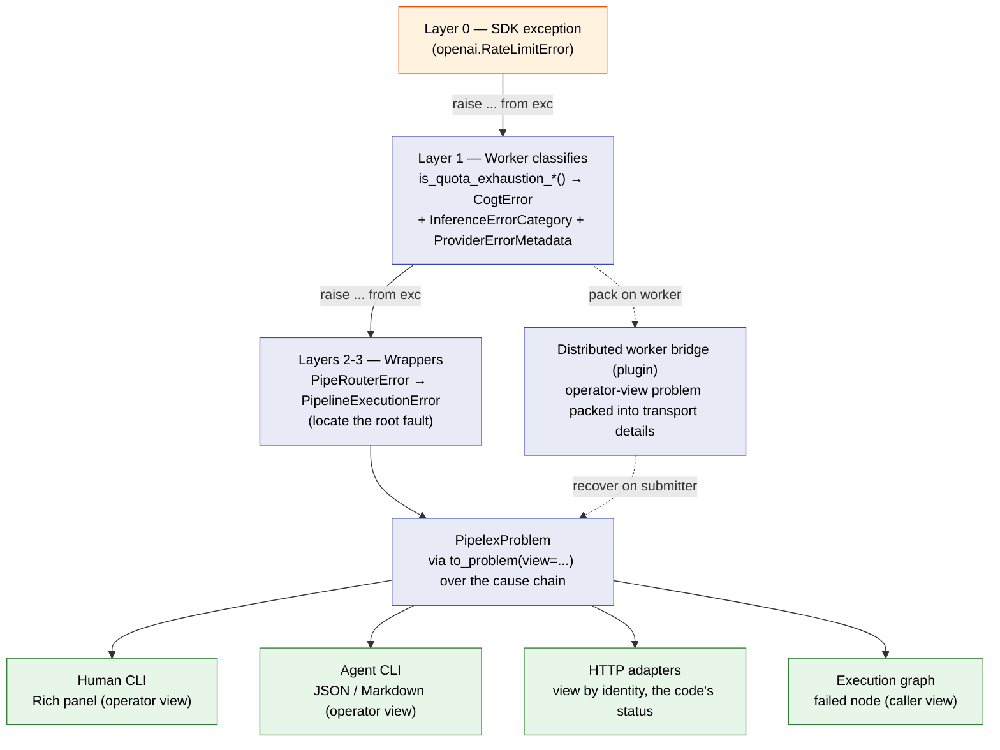

# Error Model

In Pipelex, an error is **data**, not a control-flow accident. Every failure is classified once — at the layer that knows the most about it — and that classification travels intact to every consumer: the human reading a Rich panel, the agent parsing JSON, a distributed worker's retry engine, and the HTTP adapter picking a status code.

This page covers the contract that makes that possible: the problem document every error becomes and the views its readers see it through, the registry code that decides what the problem says, the classification enums, how inference workers classify SDK exceptions, how classification survives every wrapping layer, and how a problem survives serialization across a distributed worker boundary.

---

## Design Principle

Three rules hold across the codebase, and everything else builds on them.

**Single-rooted hierarchy.** Every custom exception inherits from `PipelexError` (`pipelex/base_exceptions.py`). There is one root, so one `to_problem()` contract covers the whole tree.

**Classify at the source, never lose it.** The layer that catches a third-party exception knows the most about it. It classifies there. Every layer above is a *wrapper* — it adds context (pipe code, stack) but inherits the classification rather than re-deriving or discarding it.

**No broad catches in business logic.** `except Exception` is allowed only at CLI entry points and async task roots. Ruff rule `BLE001` enforces this — an unexpected exception crashes loudly instead of being silently swallowed.

!!! info "Why classify, instead of just propagating the exception?"
    A raw `openai.RateLimitError` tells a Python `except` clause what to catch, but it does not tell a distributed worker's retry engine whether to retry, the HTTP adapter which status to emit, or an agent whether the failure is the user's fault. Classification turns an exception into a decision input that every consumer can act on uniformly.

---

## The Layer Model

An error rises through a series of layers. Each layer has exactly one job.

| Layer | Role | What it does with errors |
|-------|------|--------------------------|
| **5 — CLI entry points** | `pipelex` / `pipelex-agent` commands | Catch, format for human (Rich) / agent (JSON·MD) / HTTP |
| **4 — CLI factories** | `cli_factory.py`, `agent_cli_factory.py` | Catch setup errors, route to handlers |
| **3 — Pipeline runner** | `PipelexMTHDSProtocol.execute()` | Catch + wrap as `PipelineExecutionError`, which reports the located root fault |
| **2 — Pipe router / operators** | `PipeRouter`, pipe operators | Catch + locate every failure as a `PipeRouterError` (`pipe_code`, `pipe_stack`); a foreign exception first becomes a `PipelexUnexpectedError` |
| **1 — Workers / SDK calls** | `pipelex/providers/*/` | **Catch the SDK exception → classify → raise `CogtError`** |
| **0 — Third-party SDKs** | OpenAI, Anthropic, Google, … | Raise raw, untyped provider exceptions |

Classification happens once, at **Layer 1**. Layers 2–5 are wrappers: they attach context as they catch and re-raise, but the registry code chosen at Layer 1, and the `error_category`, `model` and `provider` beside it, reach Layer 5 unchanged (see [Cause-Chain Facts](#cause-chain-facts)). The worker's classification picks the code, and the code decides the domain, the retry verdict, the next step, the sentences a reader is told and the HTTP status, so a single Layer-1 decision settles them all.

---

## The Problem Document

Every error becomes a **problem document**, `PipelexProblem` (`pipelex/errors/problem.py`): the MTHDS standard's problem, an RFC 9457 problem with the members the standard adds, extended with Pipelex's own. It is a frozen Pydantic model, and it is the single source of truth for what a failure says on every surface: the API's error responses, a failed run's completion webhook, a failed node of the execution graph, a distributed worker's packed failure and the agent CLI's error envelope.

| Member | Meaning |
|--------|---------|
| `type` | The code's documentation page: `https://mthds.ai/errors/<code>` for a core code, `https://docs.pipelex.com/errors/<code>` for a Pipelex code |
| `title` | The code's title, the same for every occurrence of the code |
| `status` | The HTTP status the code declares, which only the HTTP response carrying the problem sets |
| `detail` | The sentence stating this occurrence, rendered from the code's template with the problem's parameters |
| `code` | The registry code the error resolved to, a core code of the MTHDS standard or a Pipelex code: see [Error codes](#error-codes-and-the-pipelex-error-registry) |
| `domain` | Who must act, the code's registry domain: `input`, `method`, `account`, `operator` or `runtime` |
| `retry` | The code's retry verdict: `yes`, `no` or `outcome_unknown` |
| `retry_after` | The delay in seconds a provider asked for before a retry, kept only on a code whose verdict is `yes` and only when it is finite and not negative |
| `next_step` | What the reader of this view does next: its `kind` and its `detail`, the step's sentence rendered from the code's template |
| `params` | The parameters the code declares that a caller may read, by the registry's names |
| `location` | Where the fault is: the failing `pipe` and its `path` from the entry pipe, an `input`, a `field`, a batch `item`, an `attempt`, or a `file` with its `line` and `column` |
| `errors` | One item per fault, for a refusal of several at once such as a method that does not validate: each with its own `code`, `detail`, `params` and `location`, and the `suggestions` and `suggested_fix` its validation item carries |
| `pipeline_run_id` | The run the problem belongs to |
| `request_id` | The request that carried the failure |
| `run_error` | On a read of a failed run's results, the run's own problem |
| `diagnostics` | What only an operator reads, present in the operator view alone: see [Diagnostics](#diagnostics) |

No member is ever written as `null`. The model's serializer drops every member with no value, at every depth and whoever dumps the problem, alone or nested in a model that holds one (a graph node, a trace event, a webhook's payload), so a reader validating against the standard's schema never refuses it. `to_wire()` gives the problem in JSON types, and so does `as_wire()`: both walk the model by hand, as the standard's own `Problem.as_wire()` does, rather than through Pydantic's serializer, which refuses a value nested a few hundred levels deep, so every problem a reader accepts, up to the standard's `MAX_BODY_NESTING`, can be written back, a recovered one with a deeply nested extension member included, and its caller view projected (`caller_view_of()`). A problem dumped inside another model goes through Pydantic's serializer and keeps its limit.

`PipelexError.to_problem(view=...)` is the entry point. `make_problem()` builds a problem from a code and `make_problem_item()` one item of a problem with several faults, both taking everything the code decides from the registries' generated tables.

### Views: who reads the problem

A problem is one document seen through a **view**, and who reads it picks the view, never a deployment setting. `ProblemView` has two members:

- **The caller view** (`ProblemView.CALLER`) is for whoever sent the request or wrote the method. It carries no `diagnostics`, and its step is the one the code gives the actor of its domain, except on a code of the `operator` domain: that actor is whoever runs the runtime, so the caller reads the code's other step instead, what it can do meanwhile, such as choosing another model.
- **The operator view** (`ProblemView.OPERATOR`) is for whoever runs the runtime. It adds the `diagnostics`, its step is always the actor's, and it renders into that step the parameters only an operator may read.

The operator view holds everything the caller view does, so a reader holding the operator's record serves its caller from it: `caller_view_of()` drops the diagnostics, renders the caller's step again from the problem's `params`, and projects a nested `run_error` the same way. It fails closed on a code neither registry of this process holds, such as one a newer worker or a stored record carries: that step cannot be rendered again and the operator's may name an operator-only parameter, so the caller reads the generic sentence of the step's kind, and the `report` step for a code of the `operator` domain.

A third, narrower projection, `problem_metadata()`, gives a `ProblemMetadata`: what may leave a perimeter, such as a telemetry event. It holds the codes, the domain, the verdict, the step's kind, the shape of the location (the failing pipe's depth, the attempt and the batch index, naming nothing), the items' codes, the ids and the runtime version, and never a sentence, a parameter or a name a user wrote.

| Reader | View |
|--------|------|
| An API response | The view of the identity the request authenticated: the operator view for the operator's own credential and for the trusted proxy in front of the server, the caller view for anyone else (see the API server's [Error Responses](../api-server/error-responses.md#views-chosen-by-identity)) |
| A failed run's completion webhook | The view of whoever started the run, which `WebhookTarget.problem_view` carries, the caller view when the host that built the target names none |
| A failed node of the execution graph | The caller view, since whoever reads the run reads its graph |
| The human and agent CLIs, and the API's log record | The operator view, since their reader runs the runtime |
| A distributed worker's packed failure | The operator view, which the submitter projects to the view of its own reader |

### Sentences come from the code, never from the message

What a caller reads is written in the registry, not at the raise site. `detail` and the step's `detail` are rendered from the code's templates with the problem's parameters, and an error's own message, which its raise site writes for whoever debugs the runtime, rides only the operator view's `diagnostics.message`. A raise site can therefore put in its message what helps an operator, such as a path on the host, a configuration value or a foreign exception's text, and no caller reads it; what a caller needs in order to act is given as parameters.

### What a message may carry

A message reaches the operator's diagnostics, the error tracker and every log line about the failure, so it carries no run's data: never an input's value, a stuff's content, a value a pipe built or a model's answer. A raise site refusing a run's data names it by identifiers, the input, the field, the index of a list item, the concept and the kind and size of the value (`a string of 24 character(s)`, `an object of 3 key(s)`), and gives the facts its code declares as parameters; a fact its code declares no parameter for is left out. It never names the caller's own text either, a method's template source or a function's own exception text, which only a parameter its code declares as `caller_text` may carry, capped.

- **A pydantic refusal of a run's data** is written by `format_validation_error_without_input()` (`pipelex/tools/typing/pydantic_utils.py`): each error's location and reason, the reason being pydantic's own message when nothing in it came from the input, or else the error's type, such as `count: int_parsing`. A `ValidationError`'s own text quotes every value it refused, and so does the readable analysis `format_pydantic_validation_error()` gives, which is kept for the documents whose author reads them, a method or a configuration. `describe_exception_without_input()` writes any exception's text the same way, a `ValidationError`'s by its locations and reasons.
- **A validator's own sentence** is kept only when it raises `InputFreeValueError` (`pipelex/tools/typing/validation_exceptions.py`), the `ValueError` by which a validator declares that its message names what it expected and never the value. The native contents' validators raise it, a date's, a time's, a number's, an image's and a JSON object's; any other validator's message may quote the value it rejected, so it is written as its type, `value_error`.
- **A URL** is the input's value, and possibly a signed link: a refusal names the input and the scheme, and an unreachable host rides `input.url_unreachable`'s `host` parameter, never the message.
- **A function a `PipeFunc` calls** is named by the class of what it raised, `The function raised KeyError`: its text is the function's own, and `pipe.function_raised` declares no parameter for it.

Rendering never fails. A template naming a parameter the problem does not hold makes `detail` fall back to the code's title, and the step to the generic sentence of its kind, such as `Correct the method as the problem describes, then validate it again.` The fallback is logged as a warning, `A problem's sentence could not be rendered from its template`, with the code and the reason as fields, so a raise site that forgot a parameter is found in the logs while the reader still reads a sentence.

### Parameters

A code declares its parameters in the registry, each typed, and its generated parameters model validates them. A problem's parameters come from the error whose code it reports:

- **The class's facts.** A subclass holding facts its codes declare overrides `problem_params()` and returns them by the registry's names. An input-shaping error (`InputShapingError`), for one, gives the input and what its factory found wrong with it, such as the counts of `input.wrong_multiplicity` or the concepts of `input.wrong_concept`, and locates itself at the input. A fact the resolved code does not declare is left out silently, since a class's codes declare different parameters.
- **The raise site.** `with_params(**params)` gives the parameters only the raise site knows, and overrides a fact of the same name: `raise PipeRunError(...).with_error_code(CoreCode.PIPE_CONDITION_UNMATCHED).with_params(pipe=self.code)`.
- **What the run found.** A declared parameter neither of them gave is filled from the run: a failure located at a pipe gives a `pipe` parameter the failing pipe, and the model and the provider found along the cause chain give the `model` and `provider` parameters.

A parameter the code does not declare, or one of the wrong type, is dropped when the problem is built and logged as a warning naming the code and the parameter, and a number JSON cannot write, an infinity or `NaN`, counts as one of the wrong type whatever the code's model says: it is a fault of the raise site, which must never turn the error it reports into another. The parameters kept validate against the code's model and the problem's own `params` model whatever the raise site gave, so a refusal that names no parameter, such as a model-level one, drops them all rather than fail the problem's construction. A parameter the registry marks `operator_only`, such as the file and the setting of `pipelex.config.invalid` or the variable `pipelex.config.variable_missing` names, never rides `params`: it renders into the operator's step and rides `diagnostics.params`, so a caller is never told where the operator keeps a file. Nor does it ride an item's `params`: an item is the same in every view, so `make_problem()` and `caller_view_of()` take such a parameter out of every item a problem carries, whoever built the item, and render the item's sentence again without it (`item_for_every_view()`).

### Diagnostics

`ProblemDiagnostics` is what the operator view adds:

| Member | Meaning |
|--------|---------|
| `error_class` | The class of the error the problem was built from |
| `message` | That error's own message |
| `causes` | The errors along its cause chain, each with its class and the code it carries by itself |
| `params` | The parameters only an operator may read |
| `model` | The model handle, when the failure is attributable to one |
| `provider` | What the provider answered: its `name`, the backend's, its `status`, its `code`, its `request_id` and its `message` |
| `migration` | A pending configuration migration that explains the failure |
| `runtime_version` | The version of the Pipelex runtime that built the problem |
| `trace_id`, `span_id` | The OpenTelemetry span the failure happened in, when one was recording |

Every text a raise site, a provider or a caller wrote is bounded in a problem: `diagnostics.message`, the provider's message and every text parameter are cut to `MAX_PROBLEM_TEXT_LENGTH` characters by `cap_problem_text()`, which keeps the head of the text and appends ` […]`. The full text is left to the logs, so a provider's answer quoting a whole prompt cannot inflate a webhook, a stored run or a graph.

### The identity, and why renaming an error class or changing its code is a wire break

`code` is the identity a problem carries, and a consumer branches on it. `title` and `type` follow from the code, so no class declares them. The class an error was raised as is no member of the caller's problem: it rides the operator view's `diagnostics.error_class`, the agent CLI's envelope as `error_type` and the API's log record as `error.type`.

Changing the code a class declares changes what every reader is told to do, and breaks a consumer branching on the old code *silently*: its build stays green and its branch simply stops matching, falling through to a generic error path. Renaming an error class breaks whoever reads its name the same way: an agent switching on the CLI envelope's `error_type`, or an operator's log query or alert on `error.type`.

The guard against both is a committed snapshot of every class's name and code declaration at `tests/data/errors/error_identity.txt`, regenerated with `make generate-error-identity` (alias `make gei`) and gated by `tests/unit/pipelex/errors/test_error_identity_snapshot.py`. A rename or a change of code cannot land without producing a reviewable diff on that file at the moment it is made — which is also the moment to plan the matching consumer updates. The same command rewrites the static redirects of the retired per-class error pages, described below.

### Error codes and the Pipelex error registry

The MTHDS standard names every error a runner or a client can meet with a code, `input.missing` or `model.unavailable`, and publishes them as its core error registry: one entry per code, declaring its title, the domain whose actor must act, its retry verdict, its steps, the templates of its sentences, its typed parameters and its HTTP status. A problem's `type` is the code's page, `https://mthds.ai/errors/<code>` for a core code. What the standard leaves to implementations, billing, organizations, the hosted catalog, Pipelex's storage, its configuration and plugins and the components it ships, Pipelex names with codes of its own under the `pipelex` extension prefix, which the core registry registers to Pipelex: `pipelex.billing.credit_exhausted`, `pipelex.config.variable_missing`.

The Pipelex codes are authored in one public file, `pipelex/errors/registry/pipelex-error-registry.yaml`, in the standard's registry format. Everything else is generated from it with `make generate-error-registry` (alias `make ger`): the JSON snapshot `pipelex-error-registry.json` beside it, which the package ships, every release publishes as an asset, and `load_pipelex_error_registry()` (`pipelex/errors/registry/registry_document.py`) reads; the typed Python of the codes, `pipelex/errors/registry/pipelex_codes.py`, with a `PipelexErrorCode` member and a closed parameters model per code; and one page per code under `docs/errors/`, which is where a Pipelex code's type URI, `https://docs.pipelex.com/errors/<code>`, leads. [The Error Registry](../contribute/error-registry.md) describes the format's checks and the workflow.

#### Every error declares its code

Every `PipelexError` subclass declares, in its own class body, the code it raises (`pipelex/errors/error_code_declaration.py`):

- **A code**, a `CoreCode` from the `mthds` package or a `PipelexErrorCode`: every instance raises it.
- **A set**, `ErrorCodeSet(default=..., others=(...))`: the raise site that knows which applies chooses it with `with_error_code(code)`, and an instance whose raise site chose none carries the default. Two cases that need different verdicts are two codes, so a class whose raise sites need different readings declares a set, never a domain or a verdict of its own.
- **Its cause's code**, `InheritsCause(fallback=..., others=(...))`: a wrapper that adds no fact deciding the code takes its cause's, and carries its fallback when no error below it carries one. A raise site that knows the code itself may still choose the fallback or one of the `others`.
- **An abstract base**, `ABSTRACT_ERROR`: a class never raised directly.

```python
class PipeRunInputsError(PipeRunError):
    error_code = ErrorCodeSet(default=CoreCode.PIPE_INPUT_UNRESOLVED, others=(CoreCode.INPUT_MISSING,))


raise PipeRunInputsError(msg).with_error_code(CoreCode.INPUT_MISSING)
```

`PipelexError.resolve_error_code()` walks the `__cause__` chain: it stops at the first error that carries a code by itself, the code its raise site chose or its class's, descends through every error that takes its cause's code, and stops at a cause that is not a Pipelex error. When no error on the way carries one, the error reports the code the deepest error implies (`implied_error_code`, which an inference error built with a category alone names, see below), else the fallback of the deepest wrapper, and `runtime.unexpected`, whose step is `report`, when none names one. It is one walk, guarded against a cyclic chain, and no error's code starts a walk of its own. So a wrapper that adds the fact deciding the code keeps its own over a coded cause, as `pipe.function_raised` does over any coded error raised inside the method's function (the in-process executor raises what the function raised as `PipeFuncRaisedError`, so a failure of the executor itself keeps its own code; an out-of-process executor must mark the function's failure the same way, with a Pipelex error carrying `pipe.function_raised`, since an exception that is not a Pipelex error, such as a transport failure, proves nothing about the function and reads `runtime.unexpected`), and a wrapper that adds nothing passes its cause's code through.

`make_problem()` builds every problem from its code: the title, the documentation page, the domain, the retry verdict, the steps, the sentences' templates, the parameters model and the HTTP status are the code's, read from the registries' generated tables (`error_code_spec()` in `pipelex/errors/error_codes.py`), so building a problem is a pure lookup with no file read, safe inside a Temporal workflow's sandbox.

Four checks keep the declarations honest, in `tests/unit/pipelex/errors/test_error_code_gate.py`: every subclass declares a code in its own body, every declared code is registered, no subclass declares what its code decides (`error_domain`, `retryable`, a title or a type URI), and no raise constructs an abstract base. A fifth reads every `SomeError(...).with_error_code(Enum.MEMBER)` chain in the package and the runner, and fails on a code the class does not declare. A closed plugin declares at boot the public codes its errors raise, and a code neither registry holds refuses the boot.

#### Raises outside the root

An exception class outside the root carries no code, so a reader that meets one gets nothing better than the catch-all. Our own code therefore raises coded classes wherever a reader can see the raise, and `tests/unit/pipelex/errors/test_foreign_raises.py` catches a new foreign raise: `pipelex/errors/foreign_raises.py` reads every module of the package and the runner and allows by their shape the raises that are right (a builtin inside a pydantic validator, `NotImplementedError` in an abstract method, the data-model dunders Python and Jinja read, the framework carriers a library expects by type, and developer tooling), and every other foreign raise must be listed with its disposition in `tests/data/errors/foreign_raises.txt`: an invariant raised only on a bug of ours, which a boundary reports as `runtime.unexpected`, a builtin in a helper only validators call, a private class caught where it is defined, a carrier the scan cannot tell by its name (the import system's `ImportError`, the standard's method tree refusal its callers translate), developer tooling outside the exempt directories, or a builtin of a module that must import nothing of Pipelex and that its every caller catches. The check fails on an unlisted foreign raise and on a listed one that is gone.

#### The retired per-class pages

Before every error carried a code, each class had a page at `errors/<kebab-class-name>/`, which its class-derived type URI named. Those pages are retired. `mkdocs.yml`'s `redirect_maps` holds a static redirect for each, generated by `make generate-error-identity` (`pipelex/errors/retired_error_pages.py`), so a client following an old type URI, a non-browser one included, lands on the page of the class's code: the default of a set, the fallback of a class that takes its cause's code, or the error codes' index for a class that is abstract or gone. The site's `404.html` still sends any other single-segment error path to the index.

### `validation_errors` — structured bundle-validation diagnostics

A bundle-validation failure (`ValidateBundleError`) aggregates per-error data across stages and projects it onto a list of typed `ValidationErrorItem`s, which a validation verdict carries as `validation_errors` and the failure's problem as its `errors` items, so every surface carries machine-mappable diagnostics, not just a single `detail` string. Each item's `category` is one of the **closed** `ValidationErrorCategory` set:

- `blueprint_validation` — interpreter / blueprint-validation faults. A blueprint-stage `PipeValidationError` raised *inside* a pydantic model validator (e.g. the PipeBatch `input_item_name` == `input_list_name` collision, or the SubPipe `batch_over` == `batch_as` collision — both `batch_item_name_collision`) is wrapped by pydantic as a `value_error`; the blueprint categorizer unwraps it (`ctx["error"]`) so the item keeps its structured `error_type` and `pipe_code` / `domain_code` locators. The item stays in `blueprint_validation` (not `pipe_validation`) because the fault genuinely surfaced at the parse boundary, before any pipe was instantiated — only the `error_type` is recovered, not the stage. This category also serves as the **last-resort residual**: a parse-level failure (an empty blueprint, a bundle-elaborator failure) is raised with only a message and no categorized data, so when *nothing else* produced an item the builder projects that message as one `blueprint_validation` item (no `error_type`, no `source` — the bundle could not become a blueprint at all). A TOML syntax error is its own item of this category, with no `error_type`, carrying the `source` and the 1-based `line` and `column` the parser stopped at.
- `pipe_factory` — pipe-factory failures (e.g. a missing concept).
- `pipe_validation` — pipe/concept validation (missing input variable, type mismatch).
- `dry_run` — one item per pipe whose dry run failed, with the `error_type` `DryRunError`, the pipe's bare `pipe_code`, its `domain_code` and, when the library knows it, its `source`.

**Every error is an item, and none hides another.** Every pydantic error the parser meets becomes its own item: categorized when the blueprint categorizer knows it, and otherwise an uncategorized `blueprint_validation` item with no `error_type`, carrying its `source`, the `pipe_code` its location names and its `field_path`, the bundle-root path of the failing field with pydantic's own elements left out (`pipe.summarize.promtp`, not `pipe.summarize.PipeLLM.promtp`). A misspelled field beside an undeclared prompt variable therefore gives two items, where the typo used to vanish until the variable was fixed. The only error left out is the union-branch noise of a concept declared as `ConceptBlueprint | str`, whose table branch already reports the fault. The same holds inside every message `format_pydantic_validation_error` builds: the kinds it lists get their own heading, and every other kind is rendered under "Other validation errors", whatever else is present.

**A dry-run failure is one located item per failing pipe.** The dry-run sweep (`BundleValidator` in `pipelex/pipeline/bundle_validator.py`) runs each pipe through its own in-process router, which notes the first pipe each failure leaves: the innermost pipe that failed. A controller that failed because a pipe it runs failed is therefore reported at that pipe, and once, even when both were swept; validating the controller alone still reports the inner pipe. A pipe listed in `allowed_to_fail_pipes` is never where a failure is reported: a failure met there is reported at the innermost pipe around it that is not allowed to fail, the one whose failure is unexpected. When the bundle is validated from submitted content beside a host's library directories, as the hosted validator does, the item carries that pipe's `source` only when the pipe belongs to that content: a pipe loaded from the host's own library directories is named by its code and domain, never by its file on the host. A bundle validated from a file on the caller's own disk names every pipe's file, a sibling file of the same method included, and so does submitted content validated beside directories that are the caller's own (`library_dirs_are_callers`). The sweep raises one `DryRunError` whose `failures` hold one `DryRunFailureErrorData` per failing pipe, and the cascade turns each into its own `dry_run` item. Each failure carries the code of its root fault, the one a run failure reports (the first `PipelexError` down its cause chain that carries a code of its own, the walk stopping at the first exception that is not one, and of two errors of the same class the outer one, which restates the inner with a remedy), and its message names the pipe, then the sentence that code renders for a caller, never the fault's own message, because the caller reads the verdict: `Pipe '<code>' failed its dry run: <the code's detail>`. A failure with no Pipelex error on its chain is the dry run failing to mock a value, `method.mock_unsatisfiable`. The sweep reports every failing pipe this way, whatever raised the failure.

The **structured-info invariant is total**: every invalid verdict carries a non-empty `validation_errors[]`, never a bare message. The builder emits the categorized items and the `dry_run` items, then the `blueprint_validation` fallback only when nothing else produced an item.

Besides `category` and `message`, each item carries whatever identity fields its stage produced — `error_type`, `pipe_code`, `concept_code`, `domain_code`, `field_path`, `field_name`, `variable_names`, `missing_concept_code`, `declared_concepts` (on an `unresolved_concept` item, the bare codes of the concepts the validated bundle declares in the domain the reference was looked up in, native concepts excluded, and never those a library loaded before it, which may be a host's own), the TOML position `line` and `column`, the unknown-model locators `model_reference`, `model_type` and `suggestions`, the template-check locators `template_file` and `template_location` (on a `template_check_warning`, which rides `warnings`), and a `source` (the declaring file path, or the per-content source the in-memory load path was given) that hands a consumer the owning file for cross-file diagnostic placement. When the error has a deterministic remedy, the item also carries a [`suggested_fix`](#suggested_fix-structured-deterministic-fixes).

**A verdict names no path on the host.** A caller reads the verdict, its items, their locators and its message, so none of them names where the host keeps a file. A bundle of a package the method depends on by address is named by the package's address and the bundle's path inside the package, such as `github.com/acme/harbour-methods/tides/notices/tide_notices.mthds`, never by the directory the host installed the package in: that is the `source` of an item located inside the dependency and the file a duplicate declaration inside it names, on every surface, a local one included. When submitted content is validated or run, the library directories loaded beside it are the host's (installed libraries, the defaults, `PIPELEXPATH`) unless the caller says they are its own, so the verdict names none of their files: an item located in one carries no `source`, nor a `field_path` naming it, and is found by its `pipe_code` and `domain_code`, a warning found at a pipe of theirs carries no `template_file` (the sweep withholds it, `BundleValidator`'s `source_pipe_refs`), and a message that named one, named the template file a `PipeDocGen` step of theirs names (one whose template the engine's check refuses in the dry run of a caller's pipe that runs it), or named the module a Python file of theirs was imported as (two `@pipe_func` functions of the same name, for instance), reads `<host library file>` in its place (`withholding_host_library_files` in `pipelex/pipeline/validate_bundle_translation.py`). The withheld verdict is the same answer otherwise: it keeps the code its raise site chose, such as `request.invalid` for a request naming nothing to validate, and the parameters and items its raise site gave, withheld the same way. A name only counts standing on its own, never inside a longer one, and neither a source the caller submitted nor a template file its own content names is ever withheld. A method of those directories that refuses to load is not an item at all: it is the deployment's configuration failing to validate, so `reporting_host_library_faults` in the same module raises it as a `HostLibraryLoadRefusalError`, carrying `pipelex.config.invalid`, which an API answers with its code's 500, the host library's own text riding only the operator's diagnostics. A step can only name its template file relative to its bundle, so no message about one names a path on the host. A bundle validated from a file on the caller's own disk, and content validated or run against library directories that are the caller's (`library_dirs_are_callers`, an option of `validate_bundle`, of the in-process validator and of the local runtime `PipelexMTHDSProtocol`, whose `validate` and `execute` both read it), keep the full path of every file, since there the directories are the caller's own. `pipelex fix bundle --diff` leaves a dependency's address-named source as it is.

**Every refusal of the bundle is a verdict.** A validator answers either a verdict — valid, or invalid with located items — or *no verdict could be produced*, which is reserved for a failure of the tool or its environment. So a refusal raised while loading or validating a bundle becomes an item, never a no-verdict fault. After its class-specific arms, the shared cascade (`translate_to_validate_bundle_error` in `pipelex/pipeline/validate_bundle_translation.py`) turns any other `PipelexError` whose code is the method's to fix, in the `method` domain, into a verdict with one item: `pipe_validation`, with the `pipe_code`, `domain_code` and `source`, when the library load located it on the pipe it was building, and `blueprint_validation` otherwise. That item carries no `error_type`, since a refusal with a closed code has an arm of its own, and its message is the sentence the refusal's code renders for a caller (`refusal_detail()`), never the refusal's own message, which is the operator's. The location comes from the load loop in `LibraryManager.load_from_crate`, the one place that holds a pipe's code, domain and file when building it fails: it raises such a refusal again as a `PipeLoadRefusalError` naming the pipe and the file, `from` the original. A fault whose code another actor must fix, the caller's input, the account, the operator or the runtime, a `LibraryError` among them (a library invariant of ours reads `runtime.unexpected`), a `SecurityError`, a `PipeNotFoundError` (which has its own not-found handler) and anything that is not a `PipelexError` still propagate as no verdict, and so does a missing document engine, `pipelex.docgen.engine_unavailable`, which the deployment has to install. The rule therefore reaches exactly the refusals whose code is the method's. A dry run's failures and a pipe run failing outside the sweep become a verdict on the same rule: only when at least one failure is the method's. A dry run whose every failure belongs to another actor answers its own code, the first of its failures' codes by `first_fault_code()` (a verdict `no` before a retryable one, then the method's, the operator's, the account's, the input's and the runtime's, then the first given), with every failure riding its problem's `errors`, and never reads as an invalid method. The pipe factories' refusals are: `PipeLLMFactoryError`, `PipeComposeFactoryError`, `PipeExtractFactoryError`, `PipeConditionFactoryError` and `PipeParallelFactoryError` are raised only while a pipe is built, about its own blueprint, so each declares a `method` code, `method.template_invalid` or `method.schema_violation`, and a `PipeExtract` whose input is neither an image nor a document validates to one item on that pipe, saying which input to redeclare. `PipeImgGenFactoryError` is not among them: it is raised while an image-generation pipe runs, not while it is built.

**The unknown model is the worked example.** A pipe whose model field names a handle, an alias, a preset or a waterfall the model deck does not define is refused when the pipe is built: the operator's deck check raises `ModelChoiceNotFoundError`, and the operator raises it again as a `PipeOperatorModelChoiceError` located on the pipe and on the field, to which the load adds the file. Every pipe type that names a model (`PipeLLM`, `PipeStructure`, `PipeImgGen`, `PipeExtract`, `PipeSearch`) does this through the same `PipeOperator.locating_model_choice` wrapper, so each gives the same item: `category: pipe_validation`, `error_type: unknown_model`, the `pipe_code`, `domain_code` and `source`, the `field_name` and a `field_path` of `pipe.<code>.model` (`pipe.<code>.model_to_structure` for a `PipeLLM`'s structuring model), the `model_reference` exactly as written, the `model_type` (`llm`, `text_extractor`, `img_gen` or `search`), and the deck's `suggestions` of the same kind, each spelled as a reference the field accepts. The suggestions stay in the item's `message` too, for consumers that keep only the message. When the deck offers exactly one suggestion, the item carries an `unsafe` `rename-model` fix, a `remap_value` of the field from the reference as written to that suggestion. It is unsafe because the suggestion is a fuzzy match over the deck's names, which can be a different model altogether, so `pipelex fix bundle` never applies it on its own; an author or an agent applies it deliberately. An inline setting table (`model = { model = "…", temperature = 0.2 }`) is not looked up in the deck, so it is not refused here. A default the deck names itself, which a `PipeJudge` naming no model resolves as its method loads, is not the method's: the wrapper lets its `ModelDeckChoiceUnresolvedError` through unchanged, the deployment's fault and no verdict item. On a run the same refusal stops the bundle before any pipe runs, as the same `unknown_model` item (see the next paragraph).

**A run refuses an invalid bundle with the same verdict.** A run loads its bundle before any pipe runs, and the run path's `acquire_library` performs that load inside the same `translate_to_validate_bundle_error`, so a bundle the load refuses raises the `ValidateBundleError` with exactly the items validating it gives, before any inference is spent. `ValidateBundleError` carries `method.invalid`, so a hosted run route answers it with a 422 whose problem carries one `errors` item per validation item, where each refusal used to reach the host in its raw class: a misspelled concept as a `ConceptLibraryError` answered 500, a wiring mismatch as a `PipeValidationError` answered by the catch-all 500, a TOML fault as a 422 with no items, and a check firing inside a pipe's pydantic validator as a `runtime` `PipeExecutionError` reading "Input validation failed". The translation's own exceptions hold on this path too: an unknown entry pipe still raises its `PipeNotFoundError`, and a fault of the tool or its environment still propagates as itself. Two things differ from the validate path, both about whose files are loaded. The run path threads no source of its own onto its contents, so their items carry no `source`, even on a local run of a bundle file. A package the bundle depends on by address is loaded from the host's install directory within the same translation, as it is on the in-memory validate path, and a refusal inside it names the package by its address, never that directory. And the library directories load translated only when they are the caller's own, as on a local CLI run (`library_dirs_are_callers`); a host's directories (installed libraries, a temporary directory of shipped Python) load untranslated, because a fault there is not the caller's to fix: a refusal there is the `HostLibraryLoadRefusalError` described above, `pipelex.config.invalid`. The local `pipelex run` renders the verdict with the grouped panel `pipelex validate` prints, and `pipelex-agent run` copies its `validation_errors` into the error envelope.

**Signatures are never an error.** An unimplemented `PipeSignature` reached during validation is a *runnability fact*, not a validation failure: the validator no longer raises on it. The assembled library's outstanding signatures ride the validation report's `pending_signatures`, and `is_runnable = not pending_signatures`. `allow_signatures` is a sweep-mechanics flag only (whether signature pipes are mock-run and listed in `validated_pipes`) — it does not change the verdict, so strict ≡ lenient in the report body. The "is this a failure?" decision moves to the consumer: the CLI exits non-zero on `not is_runnable` unless `--allow-signatures`; the HTTP caller reads `is_runnable`. (The **execute/run** path is different: running a stub still raises `PipeSignatureNotExecutableError`.)

**Host-wiring guards are programmer errors, not content verdicts.** `validate_bundle`'s "provide exactly one of `mthds_contents` / `mthds_file_path`" guard and `resolve_crate_from_contents`'s `mthds_sources`-length-mismatch guard raise `PipelexUnexpectedError` (`runtime.unexpected`, 500), not `ValidateBundleError` — a caller wiring bug must not be reported as if the submitted bundle were invalid. The empty-`mthds_contents` guard stays the caller's, `request.invalid` (it can legitimately reflect an end user submitting no bundles).

`ValidationErrorItem` and the builder are the single source of truth across surfaces: `build_validation_error_items()` (`pipelex/pipeline/validation_errors.py`) is reached through `ValidateBundleError.validation_error_items()`, which `ValidateBundleError.problem_items()` (every problem of an invalid bundle), the validators' invalid arm, the agent CLI's `extract_validation_errors()` (the CLI JSON envelope) and `pipelex fix` all call, so the structured shapes cannot drift. `pipelex-agent validate pipe` and `validate --all` dry-run through the same cascade, so a failing dry run there is the same invalid verdict with the same items as on `validate bundle`. The item lives in `pipelex/base_exceptions.py`, not next to the source error-data models, because the root exceptions module must not import the `pipelex.core` error modules, which import back into it.

#### The `error_type` registry — the closed vocabulary of faults

An item's `error_type` names the fault it reports, and that vocabulary is closed: `pipelex/validation_error_types.py` holds it in full, enumerated as `VALIDATION_ERROR_TYPES`. A consumer that needs to know which faults the language surface can report — a coverage gate, a test corpus, a client mapping errors onto its own UI — reads that registry instead of collecting strings from whichever diagnostics it happens to have seen.

The registry is the union of the enums validation already reports through, never a second list beside them — "reports through", not "raises", because the advisory members ride `warnings` and are never raised as an exception at all: `PipeValidationErrorType` and `PipeFactoryErrorType` are the two stage vocabularies, `ValidationResidualErrorType` names the one residual channel with no stage enum of its own, `HintLintErrorType` carries the intent-hint lints (which attach to concepts and structure fields too, so the pipe enum is the wrong home for them), and `TemplateCheckErrorType` carries the warnings a `PipeDocGen` step's template check finds during the dry run (the engine reads the template file and reports in its own words, which is not the pipe's validation). A member added to any of them is in the registry the moment it is declared. `ValidationErrorItem.error_type` is typed against their union, so an unregistered string cannot be constructed or parsed onto an item — which is what makes the enumeration *closed* rather than merely documented, and what publishes the vocabulary into the OpenAPI schema `pipelex-api` serves for `/validate`.

Two spellings live in that one vocabulary, deliberately. The stage enums are snake_case codes (`missing_input_variable`); the dry-run items' code is `DryRunError`, the name of the exception that produced them, because a dry-run failure is raised as an error object rather than classified into a code. Normalizing it would be a wire break across every consumer that pins the string, and it would buy nothing — the enumeration is closed either way.

Membership means a value is *reachable on the wire*, not that it is a useful thing to exercise. Several members are advisory-only — `optional_force_redundant`, `input_presence_vacuous`, the three `hint_*` lints and `template_check_warning` — riding `warnings` and never an invalid verdict, and the two `unknown_*` fallbacks fire on states no author can ask for. A consumer building coverage over the registry excludes those on its own side with a stated reason, rather than pruning them from the runtime truth here — which is what the [MTHDS Test Corpus](../contribute/mthds-test-corpus.md) vocabulary generator already does, excluding each with its reason as it generates the `error.*` namespace from this registry.

On a problem, each validation item becomes one `errors` item (`problem_item_of()` in `pipelex/pipeline/validation_errors.py`). Its `code` is the code the item's `error_type` maps to (`validation_item_code()`), a dry-run item's is its failure's, and an item no stage classified takes the code of the refusal the verdict was built from when that refusal is the method's, else `method.schema_violation`. Its `detail` is that code's sentence, rendered from the parameters the item's locators give; its `location` holds the item's pipe, field, file, line and column; and its `suggestions` and `suggested_fix` are the item's.

```python
problem = exc.to_problem(view=ProblemView.CALLER)
problem.code  # "method.invalid"
[item.code for item in problem.errors or []]  # one code per validation item
exc.validation_error_items()  # the typed items a verdict carries as validation_errors
```

!!! info "Two shapes of the same items"
    A validation verdict — the `200` `is_valid: false` answer of the API's diagnostic routes, the CLIs' validation output and a validator's invalid arm — carries the `ValidationErrorItem`s whole, as `validation_errors`. A problem — the `422` answer of a run refused before any pipe ran — carries them as `errors` items, each with its code. Both are built from the same items, so they name the same faults at the same places.

### `suggested_fix` — structured deterministic fixes

When a validation error has a deterministic remedy, its `ValidationErrorItem` carries a `suggested_fix` — a `SuggestedFix` (`pipelex/suggested_fix.py`, deliberately stdlib+pydantic-only so `pipelex.base_exceptions` can import it without a cycle; naming is brand-neutral, fixes are a language-level concept):

- `fix_code` — the kebab-case rule id (e.g. `match-sequence-output`). The planner's `KNOWN_FIX_CODES` set is the validation set for user-facing rule filters (`--select` / `--ignore`); an unknown code is rejected loudly, never lenient-ignored, because a typo'd filter selects *behavior*.
- `description` — human-readable statement of the change.
- `safety` — `safe` fixes may be auto-applied; `unsafe` ones need a person's or an agent's confirmation, and `pipelex fix bundle` never applies them. Every prose rendering labels an unsafe fix `💡 Suggested fix (unsafe, confirm before applying):` where a safe one reads `💡 Suggested fix:`, through the one `suggested_fix_label` in `pipelex/pipeline/validation_render.py`.
- `source` — the file the ops target, when known (multi-file libraries). An applier must only apply ops to the file they target.
- `ops[]` — the fix itself, as **semantic TOML patch ops** addressed by table path (`FixOpKind`: `set_key`, `ensure_table`, `delete_key`, `delete_table`, `rename_table_key`, `move_key`, `remap_value`; each op's `table_path` follows the same conventions as the items' `field_path`). The ops are the machine contract; any rendered diff or `💡 Suggested fix:` line is presentation.

    The op vocabulary is a **discriminated union on `kind`**: one model per kind, each declaring exactly the fields its own semantics need and forbidding the rest, so `{"kind": "delete_key", …, "new_key": "x"}` is a parse error rather than a stray field the applier silently ignores. Two aliases are published from the same union — `FixOp`, every kind, which is what `ops[]` is typed as, and `MigrationOp`, the structural kinds only (`delete_key`, `delete_table`, `rename_table_key`, `move_key`, `remap_value`), which is what a configuration [migration ledger](../migration-ledger.md) is parsed against. The narrow alias is what keeps a materializing op — one that writes a value the file did not have — out of a ledger that is replayed over every user file on every run.

The **fix planner** (`pipelex/pipeline/fixes/planner.py`) translates enriched typed error data into `SuggestedFix` payloads — pure functions keyed strictly on `error_type` + structured fields, never on message strings. Each rule fires only when its enrichment is present (set only at the raise sites that know the correct value), so the same error type raised elsewhere without enrichment is structurally suppressed. The planner runs inside `build_validation_error_items()`, so every consumer of the validation report — CLI, API, MCP — sees fixes with zero extra plumbing.

Applying fixes is the runtime's job too: the **applier** (`pipelex/fix_ops/applier.py`) mutates a tomlkit DOM in place per op (guarded — an op whose target table is absent is skipped and reported, never raised) and then reflows the whole file to canonical MTHDS style, and the **convergence loop** (`pipelex/pipeline/fixes/fix_loop.py`) runs validate → apply SAFE fixes → re-validate to a fixed point, reporting non-convergence loudly. The user-facing surface is [`pipelex fix bundle`](../tools/cli/fix.md).

On the hosted API the same payload rides the wire verbatim as `validation_errors[].suggested_fix`; how it appears in HTTP error responses is documented on the API side, in the API server's [Error Responses](../api-server/error-responses.md#suggested-fixes) page.

---

## Classification Enums

Two `StrEnum`s sit beside the code. Neither decides anything a reader branches on any more: the code does.

### InferenceErrorCategory

Defined in `pipelex/cogt/exceptions.py`. It stays inside the runtime as the classification that **picks a provider failure's code**: the worker's classification (`pipelex/cogt/inference/error_classify.py`) reads the provider's answer, assigns a category and a code together, and the rendered error carries both. The category also still drives one decision the code cannot carry: whether the Temporal activity may repeat a provider call within the run, through `is_retryable` and `find_inference_error_category_in_chain`. A call whose outcome is unknown (`AMBIGUOUS`) must never be repeated within the run, though its code, `provider.outcome_unknown`, says a new run may succeed.

| Category | Meaning | Repeated within the run | Typical codes |
|----------|---------|-------------------------|---------------|
| `TRANSIENT` | A brief, self-correcting failure | ✅ | `provider.rate_limited`, `provider.unavailable`, `provider.timeout`, `provider.failed` |
| `CONFIGURATION` | The setup is wrong | ❌ | `provider.credential_refused`, `model.unavailable`, `pipelex.config.*` |
| `CONTENT` | The input or prompt is wrong | ❌ | `model.content_refused`, `model.context_exceeded`, `input.file_type_unsupported` |
| `CAPACITY` | Account quota / billing exhausted | ❌ | `provider.quota_exhausted` |
| `AMBIGUOUS` | Outcome unknown — may have committed | ❌ | `provider.outcome_unknown` |
| `UNKNOWN` | Could not classify | ❌ | `runtime.unexpected` |

The category and the code are checked against each other. A classification whose category repeats the call within the run must pick a code whose verdict invites a retry, so `ClassificationResult` and a plugin's service error vocabulary both refuse a `TRANSIENT` entry naming a code such as `runtime.unexpected`. An error a worker or a plugin builds by hand with a category and no code reports its category's code, `InferenceErrorCategory.default_error_code`, when its class declares that code and nothing down its cause chain names one: `TRANSIENT` reads `provider.unavailable`, `CONFIGURATION` `runtime.misconfigured`, `CAPACITY` `provider.quota_exhausted` and `AMBIGUOUS` `provider.outcome_unknown`, while `CONTENT` and `UNKNOWN` name no code, since a content failure may be the caller's material or a request the runtime built, and such an error keeps its class's fallback. A local `OSError` on a local extractor is the machine's, not the input's and not a provider's, so it is `UNKNOWN` with a contact-support next step and `runtime.unexpected`, and it is not repeated within the run.

!!! info "`AMBIGUOUS` vs `UNKNOWN`"
    `AMBIGUOUS` means the *error type is known* but the operation may or may not have committed — a blind retry is unsafe for a non-idempotent call. `UNKNOWN` means classification itself failed. Both are non-retryable, for different reasons.

### ErrorDomain

Defined in `pipelex/base_exceptions.py`. A problem carries its code's own domain, one of the five the MTHDS core declares; `ErrorDomain` is a three-valued reading of it, derived through `ErrorDomain.from_problem_domain()`, which the CLIs' error envelopes, the usage statistics and the API's log records still carry as `error_domain`:

| Code's domain | `error_domain` | Who acts |
|---------------|----------------|----------|
| `input` | `INPUT` | The caller, by changing the request or its inputs |
| `method` | `INPUT` | The method's author, by changing the method |
| `account` | `CONFIG` | The account's owner |
| `operator` | `CONFIG` | Whoever runs the runtime |
| `runtime` | `RUNTIME` | Nobody beforehand: wait, retry or report |

It decides nothing. The HTTP status is the code's own, declared in its registry entry (`error_code_spec(code).status`), so two codes of one domain can answer different statuses: a provider's rate limit answers 429 and its unavailability 502, both in the `runtime` domain. No class declares a domain: a class whose raise sites need two readings declares two codes, and the raise site chooses.

#### Classified where it is raised

The code says who must act and what the reader is told, so the raise site that knows which code applies, and holds the facts its sentences need, says so where it raises. A class whose raise sites need different readings declares a set, and each site chooses its code with `with_error_code()` and gives the parameters only it knows with `with_params()`:

```python
raise (
    PipeRunInputsError(message=msg, run_mode=run_mode, pipe_code=pipe_code, missing_inputs=missing_names)
    .with_error_code(CoreCode.INPUT_MISSING)
    .with_params(input=missing_inputs_str)
)
```

A pipe checking that its required inputs are present tells the two cases apart by its stack: at the entry pipe, a missing input is one the request left out, `input.missing` with its `input` parameter; below it, it is one an earlier step of the method did not produce, `pipe.input_unresolved` with its `variable` parameter. The message, which also lists the inputs that may be omitted, is the operator's diagnostics; the caller reads `The request does not give the input 'name', which the method requires.` and the step `Add the input 'name' to the request, then send it again.`

Because no caller reads a message, a raise site vouches for its message only toward the operator, and it carries no run's data even there ([What a message may carry](#what-a-message-may-carry)): a model output that does not fit its structure is named by its fields and the reasons it was refused, a `PipeFunc` crash by the class of what the function raised, a template that fails to render by Jinja2's finding without its source, and an input resource by its path on the host, while their caller reads the code's sentences. A raise site's only duty toward the caller is its parameters, which the caller view shows: it gives only the caller's own names and values (pipe codes, concept codes, variable names, the model as the method wrote it), and a fact only an operator may read is a parameter the registry marks `operator_only`.

---

## Worker Classification

Layer 0 → Layer 1. Every inference worker under `pipelex/providers/*/` catches its SDK's typed exceptions and re-raises a categorized `CogtError`.

### The Uniform Shape — Extract / Classify / Render

Every inference worker's SDK-exception handler collapses to a three-step pipeline: **Extract** turns the SDK exception into a provider-blind `ProviderErrorMetadata`, **Classify** maps that metadata to a category + user-action, and **Render** picks the `CogtError` subclass to raise.

```python
except (APIError, APIConnectionError, APITimeoutError) as exc:
    metadata = extract_openai_metadata(exc)
    classification = classify_inference_error(metadata)
    raise render_inference_error(
        metadata=metadata,
        classification=classification,
        family=InferenceErrorFamily.LLM,
        model_desc=self.inference_model.desc,
        model_handle=self.inference_model.name,
    ) from exc
```

The three steps live in three modules. Only the per-provider Extract functions stay plugin-local; Classify and Render are single shared functions.

| Module | Step | What it owns |
|--------|------|--------------|
| `pipelex/cogt/inference/error_classification.py` | Extract | `ProviderErrorMetadata`, `SDKErrorEnvelope`, `UserAction`, `UserActionKind`, the `extract_*_metadata` functions and the parsers they share (`parse_retry_after_seconds`, `error_code_from_body_code_first`), plus pure discriminators (`is_quota_exhaustion`, `is_content_policy_violation`, `is_network_error`, `is_model_not_allowed`) exposed as `@property` on the metadata |
| `pipelex/cogt/inference/error_classify.py` | Classify | `classify_inference_error()` — provider-blind mapping from `ProviderErrorMetadata` → `ClassificationResult(category, user_action_kind, is_model_not_found, service_error_code, is_model_not_allowed)`, consulting the booted plugins' service error vocabulary ahead of the status ladder |
| `pipelex/cogt/inference/error_render.py` | Render | `render_inference_error()` — picks the `CogtError` subclass from `InferenceErrorFamily` plus `is_model_not_found` (e.g. `LLMModelNotFoundError` vs `LLMCompletionError`) |

Provider-specific nuance is normalized away in Extract (e.g. Google's `code` becomes `status_code`; AWS Bedrock error codes are mapped to HTTP statuses), so Classify has no provider branching. HTTP status drives classification; status-less errors dispatch on the SDK exception type name. The `tests/unit/pipelex/cogt/inference/test_provider_classification_parity.py` meta-test walks every `ProviderName` against the extract-fn registry so adding a new provider without wiring it fails fast.

### ProviderErrorMetadata and UserAction

Every raised inference error carries structured SDK metadata and typed advice.

```python
class ProviderErrorMetadata(BaseModel):
    provider: ProviderName
    sdk_exception_type: str
    message: str = ""
    status_code: int | None = None
    request_id: str | None = None
    retry_after_seconds: float | None = None
    provider_error_code: str | None = None
    body: Any | None = Field(default=None, exclude=True)  # may carry secrets
```

!!! warning "`body` is excluded from serialization"
    The raw provider response `body` can carry account ids, billing details, or credential fragments. It is held in-process but `exclude`d from every serialized form — CLI JSON, agent output, and any serialized worker payload. The provider's `message`, the SDK exception's text, reaches only the operator's diagnostics, capped like every text a problem carries.

`UserAction` pairs a discrete `UserActionKind` (`WAIT_AND_RETRY`, `CHECK_BILLING`, `CHECK_CREDENTIALS`, `CHANGE_INPUT`, `CHANGE_MODEL`, `CONTACT_SUPPORT`, `UNKNOWN`) with a free-form `detail` string — so the local CLIs can print consistent guidance while keeping provider-specific text. It is advice for a local reader and never rides a problem, whose next step is the code's.

The `detail` is read once a run has failed and every automatic retry is spent, so it says what the reader can do next and never promises another attempt by the system: the `WAIT_AND_RETRY` advice says to wait, at least the provider's `Retry-After` delay when it gave one, then run it again.

### Service Error Codes

Not every failure on an inference call comes from a provider. A gateway or a hosted inference service may refuse a request itself, before a model ever sees it, under error codes of its own, and those refusals arrive on statuses the ladder reads as a provider rejecting the prompt. The plugin that speaks to such a service contributes the codes it emits through `PluginRegistrar.add_service_error_codes`, each with its category, its action and its advice, and `classify_inference_error` consults that vocabulary ahead of the status ladder. The seam is described in [Service Error Codes](service-error-codes.md).

### A Model the Integration Does Not Allow

One refusal outside any service's own namespace is classified by the runtime itself: `model_not_allowed_error`, Portkey's answer, at 412, when an integration serves the model but does not allow it for this caller, because the model is off the integration's allow-list or archived. Portkey's cloud emits it for a user's own workspace behind the `portkey` backend, and so does any gateway built on Portkey's middleware; the refusal means the same thing and calls for the same move from any of them, so it is matched on the code alone (`MODEL_NOT_ALLOWED_ERROR_CODE`). It carries its code in `error.type` with `error.code` null, and every Extract hop recovers it from there.

| Code | HTTP | Category / action | What the caller is told |
|------|------|-------------------|-------------------------|
| `model_not_allowed_error` | 412 | `CONFIGURATION` / `CHANGE_MODEL` | the gateway does not allow the model, named by its handle, for this account — pick another; if the pipe named it, leaving the pipe's model unset uses the default |

- **It is not a model-not-found.** The model exists and an integration serves it, only not for this caller, so `ClassificationResult.is_model_not_allowed` is set and `is_model_not_found` is not: the error stays on the family's generic failure class and carries the distinction in its advice. The ladder's generic 4xx arm would have given it the right category and advice sending the caller to edit their inputs.
- **Its advice names the model.** The refusal's message names only the backend's wire id (`us.anthropic.claude-sonnet-4-5-20250929-v1:0`), which the method's author never wrote, so the advice names the model handle the deck resolved the pipe's model to. Both of its hints are conditional, because the Render step cannot tell the cases apart: leaving the pipe's model unset helps only when the pipe named the refused model rather than falling back to it as the default, and a model deck that lists a model the allow-list refuses is the operator's to settle on a hosted gateway and the user's own on a Portkey workspace of theirs.
- **It answers 501 on an HTTP surface.** It carries `model.unavailable`, a code in the operator's domain whose registry status is 501: it lands in server-error alerting, its verdict tells a client not to retry, since an outer retry earns an identical refusal, and its caller view's step tells the caller to choose another model while the operator's tells the operator to fix the configuration.

### The `instructor` Unwrap

On structured-generation paths, `instructor` raises an `InstructorRetryException` from the exception that ended its retry loop. The loop re-asks only a response that fails the schema, so that exception is either the raw SDK exception of a call that failed in transport, or, once the re-ask budget is spent, the last parse failure. `extract_underlying_sdk_exception()` recovers it from the wrapper's cause, not from `failed_attempts`, which lists only parse failures and would name an earlier one when a re-ask then fails in transport. The recovered exception routes through the same per-provider categorization as the plain-text path. Once the re-ask budget is spent, the recovered exception is the last `pydantic.ValidationError`, whose text quotes the model's answer, so its metadata's `message` is written without it, by its locations and reasons (`describe_exception_without_input()`), and a fallback that recovers no exception names `instructor`'s by its class alone. `_STATUSLESS_BY_TYPE_NAME` classifies it as `CONTENT` / `CHANGE_INPUT` with `model.output_schema_mismatch`, a `runtime` code whose verdict invites a retry and which answers its registry status, 502. A recovered exception the classifier does not recognize lands in `UNKNOWN`.

### Model and Provider Attribution

Inference-failure leaf errors (`LLMCompletionError`, `ImgGenGenerationError`, …) are raised deep inside a plugin and do not know which model handle invoked them. Each worker family fills that in at its public-method chokepoint, and the problem then gives the model and the backend as facts, in the operator's diagnostics and as the `model` and `provider` parameters of a code that declares them:

```python
def fill_model_and_provider(self, model_handle: str | None, *, backend_name: str | None) -> None:
    """Fill model_handle / backend_name from the worker, only when still unset."""
```

---

## Cause-Chain Facts

A wrapper exception — `PipeRunError` → `PipeRouterError` → `PipelineExecutionError` — carries no classification of its own, so the problem of an error is built from its whole cause chain, and the inference classification survives every wrapping layer:

| What | Taken from |
|------|------------|
| The code, and everything it decides | `resolve_error_code()`, which walked the `__cause__` chain (see [Every error declares its code](#every-error-declares-its-code)) |
| The parameters | The error whose code it is, `code_carrier()`: its `problem_params()` and the parameters its raise site gave; then, for a parameter it gives none of, the one the nearest wrapper between the error and it gave with `with_params()`, checked against its code like any other, so a parameter the code does not declare is dropped and logged |
| The location | Each error's `problem_location()` from the error down to the one whose code it is, merged member by member with the deeper error's winning, so a wrapper that takes its cause's code and knows the pipe, the field or the file its cause was met at locates a cause that does not; a code declaring a `pipe` parameter is given the location's pipe when its raise site gave none |
| The items | The first error at or below the one whose code it is whose `problem_items()` gives any, an error that refuses several faults at once, such as one whose raise site gave them with `with_items()`; then those each wrapper between the error and it refuses, the nearest the code's carrier first |
| The facts: `model`, `provider`, `migration` and `retry_after` | For each, the one nearest the error along the chain, from each error's `problem_facts()`, so a wrapper that knows a fact overrides its cause and one that does not inherits it; the provider's answer is merged member by member, so a wrapper naming the backend keeps the status and the request id its cause recorded |
| `diagnostics.error_class`, `message` and `causes` | The error itself, then each error along its chain with the code it carries by itself |

A subclass contributes what it knows through those hooks, `problem_params()`, `problem_location()`, `problem_items()` and `problem_facts()`, and never overrides `to_problem()`, so the walk, the validation of the parameters and the views stay in one place. `CogtError` gives its model, its provider's answer and the delay the provider asked for as facts; `ValidateBundleError` gives one item per validation item. The only overrides of `to_problem()` are the two located wrappers of a run failure, which report their root fault instead of themselves (see [Run Failures: the Root Fault, Located](#run-failures-the-root-fault-located)). A host plugin's carrier of a problem recovered across a transport boundary does not override it: it overrides `recovered_problem()`, which returns that problem, in the operator's view, and is `None` on every other error, and the base `to_problem()` then reports it as it is (`recovered_problem_in_view()`), the location it is handed merged over its own, the request and the run filling the members it lacks, projected to the caller's view for a caller. Such a carrier reports a code its class does not resolve to, so a surface that reports a failure reads its code, its domain and its retry verdict off the problem it reports, as the agent CLI's error envelope and the usage statistics' error domain do, never off `resolve_error_code()` beside it. Every walk is the one cycle-guarded `iter_cause_chain()`, so a malformed chain can never turn error reporting into a hang or a `RecursionError`, and each walk that builds the problem stops at the first exception that is not a `PipelexError` (`iter_pipelex_cause_chain()`): a foreign exception raised from an earlier failure is a new failure, and nothing below it, neither a code, a fact, a location, an item nor a piece of advice, belongs to the error above it.

The advice an error carries, its `user_action`, is not a fact of its problem: the problem's step is the code's. `advised_action()` finds the advice nearest the error along its chain, and only the local CLIs print it, as a tip.

---

## Run Failures: the Root Fault, Located

When a pipe fails during a run, the error a surface receives sits under several wrappers: the pipe router's `PipeRouterError`, maybe a runtime bridge's `PipelexBridgeDispatchError`, and the runner's `PipelineExecutionError`. None of them is what went wrong, and a problem built from `PipelineExecutionError` with a bridge's sentence for a message would tell the reader nothing. So the two located wrappers, `PipeRouterError` and `PipelineExecutionError`, which take their cause's code, answer the problem of the **root fault** and only add where it happened (`pipelex/pipe_run/located_failure.py`). The root fault is the error whose code the failure resolves to: the first `PipelexError` down the cause chain that carries a code of its own, the walk `resolve_error_code()` makes, so a wrapper that adds the fact deciding the code (a PipeFunc's `pipe.function_raised` over a coded error its function raised) is the root fault over its cause; when none carries one, the deepest error implying a code, else the innermost `PipelexError`. The walk stops at the first exception that is not a `PipelexError`, whose stand-in is then the fault.

**Locating.** `PipeRouterProtocol.run()` catches every failure of the pipe it runs and re-raises it as a `PipeRouterError` chained to it, with the pipe's code and a snapshot of its stack taken where it failed. A failure that already carries a `PipeRouterError` rises untouched through the routers of the controllers above, so the innermost location is the one reported. An exception that is not a `PipelexError` first becomes a `PipelexUnexpectedError` whose message names its class (`KeyError: 'boom'`), which only an operator reads, and a dry run that sorts its own failures from programming bugs (the bundle validator's sweep, the validate surfaces' graph step) finds the foreign exception behind it with `find_foreign_fault()` and lets it propagate rather than report it as the bundle's failure. A host router whose transport raises its own failures overrides the `_as_pipelex_failure()` hook, and returns `None` for a control-flow exception such as a cancellation, which then propagates as it is. For a transport failure carrying a recovered problem, the far side packs the root fault's own problem, never a located one: when it packs that problem alone, the hook returns a `PipelexError` carrying it and the router locates it at the pipe it ran; when it packs the location it found as well, the hook returns a `PipeRouterError` rebuilt over that problem with `make_located()`, which the router raises untouched, so the problem reads exactly as the local run's. The runner wraps any failure of the run into a `PipelineExecutionError` with `make_for_run_failure()`, which takes the location from the innermost `PipeRouterError` on the chain (`find_failure_location()`), never from the live stack, which has unwound by then.

**The problem.** Both wrappers answer the same problem, the root fault's own (`located_root_fault()`), built as the wrapper reports it (`located_problem()`, over `PipelexError.problem_reported_by()`) with the location they hold:

| Member | Taken from |
|--------|------------|
| `code`, and what it decides: `type`, `title`, `domain`, `retry`, `next_step` and the HTTP status | The root fault |
| `detail` and `params` | The root fault's code and parameters, then those the wrappers above it gave for a parameter it gives none of, a code declaring a `pipe` parameter being given the failing pipe when no raise site gave one |
| `location` | The location the errors from the wrapper down to the root fault know, the root fault's winning, with `pipe`, the failing pipe, and `path`, the pipe codes from the entry pipe down to it (`failure_location_of()`) |
| `errors` | The first error along the root fault's chain that refuses several faults, then those each wrapper above it refuses |
| `diagnostics` | The root fault's class, message and causes, and the facts nearest the wrapper on its chain, so a model or a backend a worker attributed the failure to on a wrapper above the root fault is kept |

So a run failing at a nested pipe reads, in the caller view, `"location": {"pipe": "summarize", "path": ["two_steps", "summarize"]}` beside the code's own sentence about it, and the location is never parsed out of a sentence. The wrappers' own messages, which an operator meets in a traceback and the CLIs print, still read `Pipe 'summarize' failed (two_steps → summarize): Model handle 'x' was not found in the model deck.` for a nested pipe and `Pipe 'flow' failed: …` for the entry pipe; `PipeRouterError` and `PipelineExecutionError` also carry the location structurally, as `pipe_code` and `pipe_stack`.

**A recovered problem is taken as it is.** A distributed submitter receives a problem that was already located on the worker. When it raises that problem inside a `PipelexError` whose `recovered_problem()` returns it, which its `to_problem()` then reports in the view asked for with the location it is handed, and no `PipeRouterError` sits on the submitter's own chain, the runner's `PipelineExecutionError` reports it unchanged: its `pipe_code` is the entry pipe, its `pipe_stack` is empty, and it adds no location of its own. A located problem must never reach a router this way, since the router would locate it again: that is why a host router's transport packs the root fault's own problem. Only that hook makes a root fault report its own problem as it is: an inner `PipeRouterError` standing for a foreign exception, under a wrapper that attributed the failure to a model, is reported as the runner's wrapper reports it, so the model and the backend reach the problem. A bridge's own sentence (`Pipe execution failed in DIRECT mode …`) appears nowhere in the problem, so a run gives the same problem whether it ran in process, through the in-process orchestrator or on a remote worker.

**Where the remedy goes.** A problem's next step is its code's, the same on every surface, a hosted run's stored error included. Advice that only a local reader can act on belongs to the local CLI: `pipelex run` renders the model panel of a `PipeOperatorModelAvailabilityError` found anywhere on the chain, and the panel's tip is where the local model deck remedy lives.

---

## Crossing a Distributed Worker Boundary

The error model is built to survive serialization. A problem is a model with a published schema, so a failure that happens on a remote worker reaches the submitting process with its code, its parameters, its location and its diagnostics intact — not just a message string.

The runtime itself stays transport-agnostic: the machinery that carries an error across a worker boundary ships in the **host-runtime plugin** for each distributed backend, not in core. A backend plugin is responsible for three things.

**Packing.** Convert a `PipelexError` into the transport's failure type and stash the root fault's problem, in the operator's view, in its details payload (`to_problem(view=ProblemView.OPERATOR).to_wire()`), so worker and submitter code keep the code and the full classification rather than a bare message. The same step derives the transport's retry decision from `InferenceErrorCategory.is_retryable`, which tells a provider call that may be repeated within the run from one whose outcome is unknown.

**Recovering.** On the submitter side, walk the returned failure, pull the packed problem and validate it back into a `PipelexProblem`, carried by a `PipelexError` whose `recovered_problem()` returns it, which its `to_problem()` then reports in the view asked for. Recovery is **total**: when no problem is found — a non-Pipelex exception, a worker crash, a timeout — the plugin answers `runtime.unexpected`, so the recovery path always has a structured problem to surface.

**A fail-safe floor.** Ensure a domain error that escapes the conversion path fails the unit of work *terminally* rather than hanging. In a durable-execution system the default for an unconverted exception might be to retry forever, so "convert all the errors we know about" is not enough — the floor must hold for the errors, and the code paths, that nobody enumerated.

**Net effect:** a pipe failing on a remote worker reaches the CLI and HTTP adapters with the *same* problem as the identical failure run locally — and a failure that escapes conversion fails loud and bounded instead of hanging. `pipelex.test_extras.problem_parity`, shipped in the package, holds the injected failures and their expected code, domain, verdict and operator step kind (`ProblemParityTestData`, `SearchProblemParityTestData` and `JudgeProblemParityTestData`), so this repository's local arm and a distributed plugin's arm check the same classification against the same data.

See [Runtime Bridge & Transport](./runtime-bridge-and-transport.md) for the boundary these converters span; the per-backend converters themselves live in the host-runtime plugins.

---

## Interfaces

### CLI

The agent CLI (`pipelex-agent`) emits a structured error to **stderr**, markdown by default and JSON with `--error-format json`. When `--error-format` is omitted it **inherits the value of `--format`** (the success-output flag) — so `--format json` still flips both as it did before the split. Both exit with code 1.

| Command | Error output |
|---------|--------------|
| `run`, `validate`, `init`, `models`, `check-model`, `doctor` | Markdown (default) or JSON via `--error-format` (or via `--format`, which `--error-format` inherits) |
| `inputs` | JSON only |
| `fmt`, `lint` | Native `plxt` output (subprocess passthrough); falls back to JSON only when the `plxt` binary itself is missing |

The human CLI (`pipelex`) renders a Rich error panel — red banner, structured fields, the `user_action` tip, doc/Discord links — through the shared `display_error_panel()` helper in `pipelex/cli/error_handlers.py`.

#### Validate exit-code policy (0 / 1 / 2)

The `validate` surface — both the bare `pipelex validate {bundle,method,pipe}` group and the agent CLI's `pipelex-agent validate` — exits with **three** codes that mirror the hosted `/validate` 200-verdict-vs-non-2xx-no-verdict split:

| Exit | Class | Condition |
|------|-------|-----------|
| `0` | valid | `is_valid` — including valid-but-not-runnable **with** `--allow-signatures` |
| `1` | negative verdict | a produced "no": an invalid bundle (`ValidateBundleError`), or valid-but-not-runnable **without** `--allow-signatures` (a strict signature breach) |
| `2` | no verdict | the CLI could not produce a verdict — bad args, an unresolvable target (no `.mthds` in a directory, a missing file, an unknown/ambiguous pipe code), or a setup/internal error during validate |

**The verdict lives in the structured `is_valid` field, not the exit code.** The exit code is a convenience signal for naive shell/CI/Makefile use (`set -e`, `cmd && next`, `if cmd; then`); machine consumers (hooks, the Codex hook, runners) MUST read `is_valid` (and `error_domain`) from the JSON for their block/warn decisions rather than branching on the exit code. Decoupling the verdict from the exit code is what keeps any future exit-code change non-breaking. The 1-vs-2 split is also additive for flat consumers: both stay non-zero, so anything that only tests zero-vs-non-zero is unaffected.

Implementation: the agent CLI threads `exit_code` through `agent_error(...)` (`agent_output.py`, default 1); the validate commands pass `exit_code=2` at every no-verdict site and keep the default 1 on the `ValidateBundleError` arm and the signature gate. The bare CLI sets the code directly via `typer.Exit(...)` in `cli/commands/validate/*` and via the `exit_code` parameter on `handle_model_availability_error` in `cli/error_handlers.py`. Every refusal of the bundle is a negative verdict on both CLIs: `validate bundle` and `validate method` validate through the shared cascade, and `validate pipe` and `validate --all` load their libraries through it too, so an unknown model or any other load-time refusal exits 1 with the invalid-bundle output rather than a traceback or the no-verdict exit 2. The bare `validate pipe` and `validate --all` also run their dry run through it, so a pipe whose dry run fails is rendered like any other invalid bundle; the agent CLI answers that failure with its `DryRunError` envelope, `is_valid: false` and exit 1. Shared boot handlers (`make_pipelex_for_cli`'s telemetry-config and model-deck-preset paths) stay exit 1 — they are shared across `run`/`build`/`validate` and out of the validate-policy scope.

### API

The `pipelex` library serves no HTTP itself; the API server, the repository's `api/` member, answers every failure with its problem (see the API server's [Error Responses](../api-server/error-responses.md)). Everything an HTTP adapter needs is the library's:

- `PipelexError.to_problem(view=ProblemView.OPERATOR, request_id=...)` builds the problem, which the adapter logs, then projects with `caller_view_of()` when the request's identity is not the operator's.
- The HTTP status is the code's, `error_code_spec(code).status`, with 500 for a code the registries give none.
- A `Retry-After` header rides only a 429, from the problem's `retry_after`, which only a code inviting a retry carries.

An adapter is therefore a trivial renderer: it must not redefine a status, a domain or a sentence.

### Inputs and Outputs

**Inputs.** `to_problem()` takes a live `PipelexError` and the view of its reader. `PipelexProblem.model_validate()` takes a problem's wire form, which a distributed worker's bridge or a stored run hands back. (The cross-boundary recovery helper that walks a returned failure and rebuilds the problem lives in the host-runtime plugin, not core.)

**Outputs.** `to_problem()` returns a `PipelexProblem`; `to_wire()` returns its JSON form with no member written as `null`. Side effects: a warning logged for a parameter the code does not declare or a sentence that could not be rendered; telemetry events emitted on pipeline failure at Layer 3, which carry the problem's metadata view; the agent CLI writes to stderr and raises `typer.Exit(...)` — code 1 by default, or the validate surface's 0/1/2 policy (see [Validate exit-code policy](#validate-exit-code-policy-0-1-2)).

---

## Architecture



---

## Implementation

### Class Hierarchy

`PipelexError` is the single root, and every subclass declares its code (see [Every error declares its code](#every-error-declares-its-code)). `CogtError` is the inference branch: an abstract base whose subclasses declare the codes the classification picks from, which overrides `problem_facts()` to give the model, the backend, the provider's answer and the delay the provider asked for, and `implied_error_code` to name its category's code for an error built with a category alone.

```
Exception
└── PipelexError                  base_exceptions.py — error_code, with_error_code(), with_params(), resolve_error_code(), to_problem()
    ├── PipelexUnexpectedError     → runtime.unexpected
    ├── PipelexConfigError         → one of pipelex.config.invalid, .syntax, .file_missing; gives its migration as a fact
    ├── PipelexSetupError          → inherits its cause's code, else runtime.misconfigured
    ├── CogtError                  cogt/exceptions.py — abstract; error_category, provider_metadata, problem_facts()
    │   ├── LLMCompletionError      ← a set the worker's classification picks from
    │   ├── ImgGenGenerationError   ← a set the worker's classification picks from
    │   └── ... (see worker classification) ...
    ├── PipelineExecutionError      pipeline/exceptions.py — answers its located root fault's problem
    └── ... (one exceptions.py per package) ...
```

### Factory-time vs Runtime

| When | What carries metadata | How |
|------|----------------------|-----|
| **Class definition** | `error_code` (a code, a set, its cause's, or abstract), `error_category` defaults, `user_action` defaults | Class-level attributes — one source of truth per exception type |
| **Raise time** | The code chosen from the class's set, the parameters only the raise site knows, per-instance `error_category`, `user_action`, `provider_metadata` | `with_error_code()`, `with_params()` and constructor args — set by the raise site or the worker that classified the failure |
| **Problem time** | The resolved code and everything it decides; the parameters, location, items and facts along the chain; the view | `resolve_error_code()`, `code_carrier()` and the problem hooks; `fill_model_and_provider()` at the worker chokepoint; `make_problem()` |

The "outcome" exceptions (`LLMCompletionError`, `ImgGenGenerationError`, `ExtractJobFailureError`, `SearchJobFailureError`) intentionally carry **no** class-level `error_category` — their category and their code are genuinely per-instance, decided by the worker.

---

## Reference

### Quick-Ref

```python
# Build the problem of any PipelexError, in its reader's view
problem = exc.to_problem(view=ProblemView.CALLER)  # code, sentences, step, params, location
operator_problem = exc.to_problem(view=ProblemView.OPERATOR, request_id=request_id)  # adds the diagnostics
payload = problem.to_wire()  # JSON types, no member written as null


# Declare a class's code; choose one of its set and give its parameters where it is raised
class SomeError(PipelexError):
    error_code = ErrorCodeSet(default=CoreCode.INPUT_INVALID, others=(CoreCode.INPUT_MISSING,))


raise SomeError(msg).with_error_code(CoreCode.INPUT_MISSING).with_params(input="topic")

# Consume a problem
problem.code  # "input.missing" — the code decides everything below
problem.next_step.kind  # "change_input"
problem.location  # the failing pipe and its path, on a run failure
error_code_spec(exc.resolve_error_code()).status  # 422 — the HTTP status

# Project a problem built in the operator's view
caller_view_of(problem=operator_problem)  # what a caller reads
problem_metadata(problem=operator_problem)  # codes, verdicts and shapes, with no sentence or name

# Round-trip across a boundary
PipelexProblem.model_validate(payload)

# Retry decision within a run
InferenceErrorCategory.TRANSIENT.is_retryable  # True — only TRANSIENT
```

### File → Purpose

| File | Purpose |
|------|---------|
| `pipelex/base_exceptions.py` | `PipelexError` and its problem hooks, `ErrorDomain`, `ValidationErrorItem` |
| `pipelex/errors/problem.py` | `PipelexProblem`, `ProblemView`, `ProblemDiagnostics`, `make_problem()`, `make_problem_item()`, `caller_view_of()`, `recovered_problem_in_view()`, `problem_metadata()`, `cap_problem_text()` |
| `pipelex/errors/error_code_declaration.py` | What a class declares: a code, `ErrorCodeSet`, `InheritsCause`, `ABSTRACT_ERROR` |
| `pipelex/errors/error_codes.py` | `ErrorCode`, `error_code_spec()`: what the registries declare about each code, as generated tables, and `first_fault_code()` |
| `pipelex/errors/bundle_validation_failure.py` | `BundleValidationFailure`, a bundle validator's invalid arm: the refusal's problem and its validation items |
| `pipelex/errors/foreign_raises.py` | The scan behind the foreign-raise check |
| `pipelex/errors/retired_error_pages.py` | The static redirects of the retired per-class error pages |
| `pipelex/errors/registry/pipelex-error-registry.yaml` | The Pipelex error registry, the single source of the `pipelex.` codes; its snapshot, its typed codes (`pipelex_codes.py`) and its pages are generated from it |
| `pipelex/errors/registry/registry_document.py` | The typed model of an MTHDS error registry, and `load_pipelex_error_registry()` |
| `pipelex/pipe_run/located_failure.py` | `find_root_fault()`, `located_root_fault()`, `failure_location_of()`, `make_unexpected_failure()` |
| `pipelex/graph/node_problem.py` | `make_node_problem()`: the caller-view problem a failed node of the execution graph records |
| `pipelex/pipeline/validation_errors.py` | `build_validation_error_items()` — shared CLI/API structured bundle-validation builder — and `problem_item_of()` |
| `pipelex/validation_error_types.py` | The closed `error_type` registry — `VALIDATION_ERROR_TYPES`, `PipeValidationErrorType`, `PipeFactoryErrorType`, `ValidationResidualErrorType`, `HintLintErrorType` |
| `pipelex/cogt/exceptions.py` | `CogtError`, `InferenceErrorCategory` |
| `pipelex/cogt/inference/error_classification.py` | Extract — `ProviderErrorMetadata`, `SDKErrorEnvelope`, `UserAction`, `UserActionKind`, per-provider `extract_*_metadata` functions, pure discriminators |
| `pipelex/cogt/inference/error_classify.py` | Classify — `classify_inference_error()`, `ClassificationResult` |
| `pipelex/cogt/inference/error_render.py` | Render — `render_inference_error()`, `InferenceErrorFamily` |
| `pipelex/cogt/inference/provider_name.py` | `ProviderName` enum keying the extract-fn registry |
| `pipelex/providers/*/` | Per-provider inference workers — Layer 0 → 1 classification |
| `pipelex/pipeline/exceptions.py` | `PipelineExecutionError`, `PipeExecutionError`, `ValidateBundleError` |
| `pipelex/test_extras/problem_parity.py` | The failures and expected classifications the local and distributed parity tests share |
| `pipelex/cli/error_handlers.py` | Human CLI Rich panels — `display_error_panel()` |
| `pipelex/cli/agent_cli/commands/agent_output.py` | Agent CLI JSON / markdown delivery |

### Behavior Summary

| Scenario | Behavior |
|----------|----------|
| Rate limit hit | `TRANSIENT` → repeated within the run; `provider.rate_limited`, whose verdict invites a retry and which answers 429, with a `Retry-After` header when the provider gave a delay; transport retry honors `Retry-After` |
| Quota / billing exhausted | `CAPACITY` → not repeated; `UserAction(CHECK_BILLING)`; `provider.quota_exhausted`, the operator's → HTTP 502 |
| Bad API key | `CONFIGURATION` → not repeated; `provider.credential_refused`, the operator's → HTTP 502 |
| Model or deployment not found (provider HTTP 404) | Raises a dedicated `*ModelNotFoundError` sibling (`LLMModelNotFoundError`, `ImgGenModelNotFoundError`, `ExtractModelNotFoundError`, `SearchModelNotFoundError`) carrying `model.unavailable`, since a method cannot name a provider's raw model id; operator re-raises `PipeOperatorModelAvailabilityError` |
| Model reference unknown to the deck (a method naming `gpt-5.1`, a mistyped `@alias` or `$preset`) | `ModelChoiceNotFoundError` → `CONFIGURATION` category, but the code `model.unknown`, the method's → **HTTP 422**, whose sentence names the reference and whose `suggestions` parameter carries the deck's close matches, which are all a caller needs to fix the method. A handle the deck serves only as another type of model is `model.capability_unsupported` |
| The deck's own default or override names a model it does not define | `ModelDeckChoiceUnresolvedError`, naming the deck setting in its message for the operator, never the caller's `model.unknown`: `model.unavailable` → HTTP 501, with the reason `not_served`, for a bare handle no backend serves as the type the step needs, whose caller step offers another model, and `pipelex.config.invalid` → HTTP 500 for a preset, an alias or a waterfall the deck does not define; a bad override is refused when the deck is built |
| Content-policy violation | `CONTENT` → not repeated; `UserAction(CHANGE_INPUT)`; `model.content_refused` → **HTTP 422** |
| Malformed prompt image / bad prompt parameter | `CONTENT` class-level (`PromptImageFormatError`, `LLMPromptParameterError`, …), each with its own code (`input.file_type_unsupported`, `pipe.prompt_empty`, …) |
| Any other provider **HTTP 400** | `CONTENT` / `CHANGE_INPUT`, but `runtime.unexpected` → HTTP 500: a 400 nothing recognises is most likely a request of ours the provider could not take, and only a content-policy signal makes it the caller's `model.content_refused` |
| Local file extractor raises a builtin (docling, pypdfium2) | `FileNotFoundError` → `input.reference_not_found`, `ValueError` / `RuntimeError` → `input.file_unreadable`, both `CONTENT` → **HTTP 422**; `OSError` → `UNKNOWN`, `runtime.unexpected` (see `_LOCAL_EXTRACT_BY_TYPE_NAME`) |
| A text completion stops at its output limit or context window (`length`, `max_tokens`, `MAX_TOKENS`, an `incomplete` Responses answer at `max_output_tokens`, `model_context_window_exceeded`, `model_length`), with partial or empty text | Every LLM worker reads the stop before returning text and raises `LLMCompletionTruncatedError` → `CONTENT` / `CHANGE_INPUT`, not repeated: `model.output_truncated`, the method's, at the output limit, which the method's `max_tokens` sets, and `model.context_exceeded`, the input's, at the context window, both → **HTTP 422**. The message, for the operator, names the model, the pipe, the stop value, the output tokens used and the `max_tokens` sent, never the partial text; the caller reads the code's sentence, with the model and the token counts as its parameters. The error's `truncation_limit` tells the output limit from the context window (`model_context_window_exceeded`, `model_length`), and so does its code's next step: a higher `max_tokens` for the first, a shorter input for the second. A gateway in non-strict mode passing each provider's own value through the completions shape is read the same way, since the classifier reads the union of the provider vocabularies |
| A text completion refused or stopped by a safety filter (`content_filter`, `refusal`, `content_filtered`, `guardrail_intervened`, Gemini's `SAFETY` and its kin), or a Gemini prompt blocked before any candidate (its `prompt_feedback.block_reason`, whatever its value) | `LLMCompletionRefusedError` → `CONTENT` / `CHANGE_INPUT`, not repeated; `model.content_refused` → **HTTP 422** |
| A stop value no provider vocabulary lists | Logged at warning level with the model and the value, and taken as normal: the text is returned. An `incomplete` Responses answer whose reason is missing or unknown is the exception: logged at warning level and taken as a truncation, since the status alone says the text is unfinished |
| An Anthropic structured generation whose `max_tokens` its structured-output timeout lowers | Sent with the lowered limit; logged at warning level when the pipe set the limit, at debug level when it is the model's default; an error the lowered limit can explain, a structured output that failed validation or came back incomplete once the re-asks are spent, or a timeout, keeps its class and category and its message ends with a sentence saying the limit was lowered and to what; a rate limit, an authentication failure, an overload, a server error or a lost connection carries no such sentence |
| LLM returns schema-mismatched JSON | `instructor` re-asks; if exhausted → the last `pydantic.ValidationError` → `CONTENT` / `CHANGE_INPUT`, `model.output_schema_mismatch` → HTTP 502, whose verdict invites a retry |
| The gateway does not allow the model for this account (`model_not_allowed_error`, HTTP 412) | `CONFIGURATION` / `CHANGE_MODEL`, never repeated; the advice names the model handle; `model.unavailable` → HTTP 501 |
| Connection dropped mid-request | `AMBIGUOUS` → not repeated within the run (outcome unknown); `provider.outcome_unknown` → HTTP 502, whose sentence says the work may exist and be billed, and whose step says to run the method again only if a repeat of the work is acceptable |
| A step names, in an inline model setting, a model the deck neither defines nor names | `ModelNotFoundError`, which the lookup raises with `model.unknown` as the method's: **HTTP 422**, with a `change_model` step and a sentence naming the model as the method wrote it and the type of model the step needs. A model the deck itself names but does not serve (a preset or alias on a backend that is not enabled) keeps the class's `model.unavailable` → HTTP 501, in the operator's domain, whose caller step offers another model |
| A `PipeParallel` cannot combine its branch results, or a pipe starts without a required input | The caller's own method or request: `pipe.output_multiplicity`, naming the first branch whose multiplicity differs from its field's, with one item per such branch when there are several, or `input.missing` at the entry pipe and `pipe.input_unresolved` below it → **HTTP 422**, each with its code's step, `change_method` for the method's codes and `change_input` for the input's |
| Unknown or ambiguous entry `pipe_code` (a CLI argument, a run request's field, the `--pipe` / `pipe_ref` slice selector of bundle validation) | `EntryPipeNotFoundError` / `EntryPipeAmbiguousError` → `UserAction(CHANGE_INPUT)`; `request.pipe_not_found`, `request.pipe_unspecified` or `request.pipe_ambiguous` → **HTTP 422**. The in-body lookups (`get_optional_pipe` / `get_required_pipe`) keep raising `PipeNotFoundError` / `PipeLibraryError`, whose codes are the method's: a ref written inside a bundle is not the caller's input |
| A template naming a filter or a test that does not exist, found only when it renders | `Jinja2TemplateInvalidError` at the pipe, naming the filter or test and none of the template: `method.template_invalid` → **HTTP 422** for a method's `PipeCondition` expression, `PipeLLM` prompt or `PipeDocGen` template, and `runtime.unexpected` for one of Pipelex's own templates |
| A URL or a storage key refused by the SSRF guard or the run's read scope | A `security.*` code saying whose the URL was: `security.input_url_refused` for one of the run's inputs, the default when the guard cannot tell, `security.method_url_refused` for one the method names and for a read refused inside a step, whose inputs were authorized when they were normalized, both → **HTTP 422**, and `security.provider_url_refused` for one in a model's generated answer, the runtime's → HTTP 502; a traversal in a storage key the caller supplied is `security.input_path_refused`, which `PipelineInputContentError` takes from its cause |
| A method of the host's own library directories refuses to load | `HostLibraryLoadRefusalError`, `pipelex.config.invalid` → HTTP 500, its message the operator's alone; the same refusal in the caller's own content stays the caller's verdict |
| Wrapper exception (no own category) | Takes its cause's code, and its parameters and facts from the chain |
| A pipe fails during a run | `PipeRouterError` → `PipelineExecutionError`, both answering the root fault's problem, its `location` naming the failing pipe and its path from the entry pipe; their own messages, for the operator, are the root fault's prefixed with `Pipe '<code>' failed (<path>): ` |
| A pipe raises a non-Pipelex exception | Located as a `PipelexUnexpectedError` whose message names the original class; `runtime.unexpected`, its message the operator's alone |
| Failure on a distributed worker | The problem recovered from the transport's serialized details — the same as local |
| Worker exception with no packed problem | A fallback problem — `runtime.unexpected` |

---

## Next Steps

- [Pipe Routing & Execution](./pipe-routing-and-execution.md) — the layer model errors rise through
- [Runtime Bridge & Transport](./runtime-bridge-and-transport.md) — the process boundary the error bridge spans (the per-backend error converters live in the host-runtime plugins)
- [Inference Configuration](../configuration/config-technical/inference-config.md) — `transport_max_retries` and the Tier 1 retry policy
- [Agent CLI](../tools/cli/agent-cli.md) — the JSON / markdown error contract
