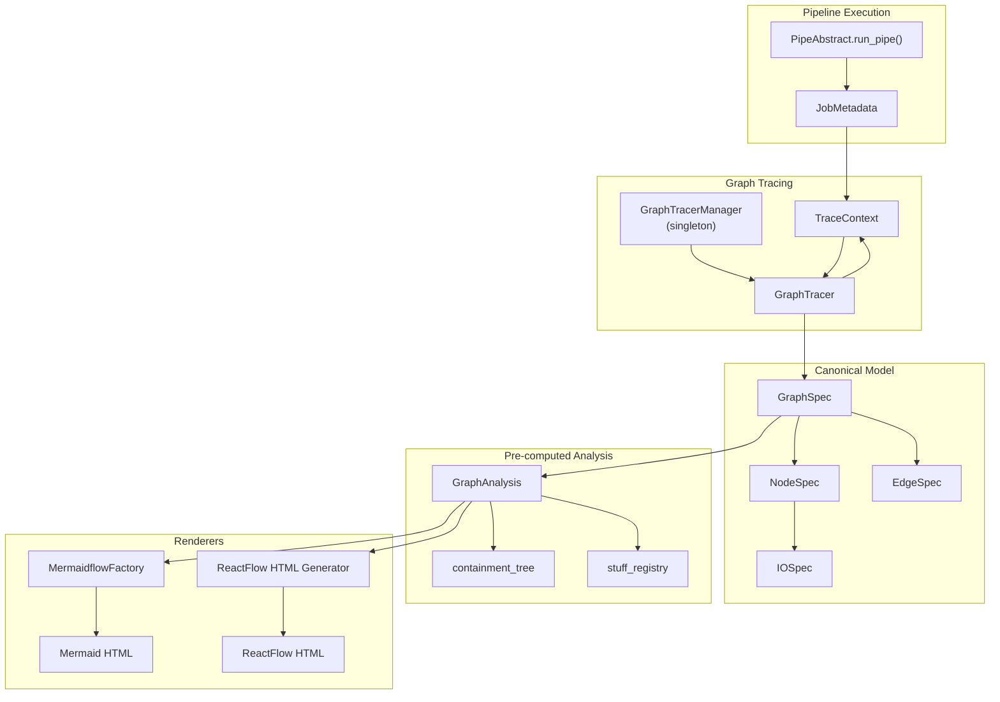

# Execution Graph Tracing

Pipelex captures pipeline executions as directed graphs for visualization and debugging. The `pipelex/graph/` module provides tracing infrastructure, a canonical data model (GraphSpec), and multiple rendering backends (Mermaid, ReactFlow).

---

## Design Principle

Pipeline executions form implicit graphs: pipes call other pipes, data flows between them. The graph module makes this structure explicit:

1. **Trace at runtime**: Instrument pipe execution to capture nodes (pipes) and edges (relationships)
2. **Store canonically**: GraphSpec is a versioned, renderer-agnostic JSON model
3. **Render as needed**: Transform GraphSpec into Mermaid diagrams or ReactFlow visualizations

```
Pipe Execution → GraphTracer → GraphSpec → Renderers → HTML/Mermaid
```

!!! info "Non-Intrusive Design"
    Graph tracing is opt-in. When disabled, a no-op tracer is used with zero overhead. The tracer is injected via `TraceContext` in `JobMetadata`, not global state.

---

## Usage Variants

| Scenario | CLI | API | Result |
|----------|-----|-----|--------|
| Generate execution graph | `pipelex run pipe my_pipe --graph` | `PipelexMTHDSProtocol(execution_config=...).execute(...)` | GraphSpec JSON + HTML viewers |
| Force include full data | `--graph --graph-full-data` | `data_inclusion.stuff_json_content=True` | Data embedded in IOSpec |
| Force exclude data | `--graph --graph-no-data` | The stuff and error `data_inclusion` flags → `False` (`pipe_and_concept_registry` unaffected) | Previews only |
| Dry run with graph | `--dry-run --graph` | `PipelexMTHDSProtocol(pipe_run_mode=PipeRunMode.DRY, execution_config=...)` | Graph of mock execution |

!!! info "JSON Data Included by Default"
    The default configuration includes the serialized data in graphs: `stuff_json_content`, `error_stack_traces` and `pipe_and_concept_registry` are `true`. A traced input or output carries that JSON content and nothing else — the text and HTML renderings a run used to build for every one of them are gone, because they cost a render on the execution path, growing with text volume times nesting depth, and only the Mermaid viewer read them. `--graph-full-data` turns the data flags on and `--graph-no-data` turns them off, overriding project-specific settings; `pipe_and_concept_registry` is set only via config.

---

## Interfaces

### CLI Commands

```bash
# Run pipeline and generate graph
pipelex run pipe my_pipe --graph

# Include full serialized data
pipelex run pipe my_pipe --graph --graph-full-data

# Exclude data (previews only)
pipelex run pipe my_pipe --graph --graph-no-data

# Dry run with graph tracing
pipelex run pipe my_pipe --dry-run --graph --mock-inputs
```

### API

```python
from pipelex.pipeline.runner import PipelexMTHDSProtocol
from pipelex.system.pipe_run_mode import PipeRunMode

# Execute with graph tracing via config
runner = PipelexMTHDSProtocol(
    execution_config=config.with_execution_overrides(generate_graph=True),
)
response = await runner.execute(
    pipe_code="my_pipe",
)
pipe_output = response.pipe_output

# Dry run with graph: the same runner in DRY mode with mock inputs — no separate code path.
dry_runner = PipelexMTHDSProtocol(
    pipe_run_mode=PipeRunMode.DRY,
    execution_config=config.with_execution_overrides(generate_graph=True, mock_inputs=True),
)
response = await dry_runner.execute(pipe_code="my_pipe")
graph_spec = response.pipe_output.graph_spec
```

!!! tip "Dry run from MTHDS content"
    To dry-run an entire bundle straight from MTHDS content and get back a `GraphSpec`, use `dry_run_pipeline(mthds_contents=...)` (`pipelex/pipeline/dry_run_pipeline.py`) — the shared entrypoint behind the CLI graph commands, which wires the same DRY-mode runner for you. It owns its graph transport (a scoped in-memory event log), so it produces the graph regardless of the host's `tracing_config` and never writes trace files as a side effect.

### Outputs

| Output | File | Purpose |
|--------|------|---------|
| `graphspec_json` | `graphspec.json` | Canonical graph representation |
| `graphspec_json` | `pipe_io_contracts.json` | The graphspec's companion: each pipe's I/O contract, keyed by `pipe_ref` |
| `graphspec_json` | `input_form.json` | The graphspec's companion: each pipe's input-form descriptor |
| `graphspec_json` | `output_form.json` | The graphspec's companion: each pipe's output-form descriptor |
| `mermaidflow_mmd` | `mermaidflow.mmd` | Mermaid flowchart code |
| `mermaidflow_html` | `mermaidflow.html` | Standalone Mermaid viewer |
| `reactflow_html` | `reactflow.html` | Interactive ReactFlow viewer |

The three companions are the validation report's `pipe_io_contracts`, `input_form` and `output_form` under the standard's names: a graph carries every payload the run produced and nothing that says what those payloads are, and a graph viewer (`@pipelex/mthds-ui`'s `GraphViewer`) shows a data node's value only when it holds both the contracts and the output form for the producing `pipe_ref`. They are built once, at the end of `PipeRun.run` inside the run's own library window (the builders need the loaded library, which `PipelineRunner.execute` tears down before the CLI writes anything), over the run library's own pipes (the validated bundle and whatever `library_dirs` loaded beside it; a dependency package's pipes are keyed by alias in the library and described by no blueprint the host holds, so they are left out, as a validation of the bundle leaves them out), and carried on `pipe_output.pipe_io_artifacts` beside `graph_spec`; a failure of the builders, whatever its kind, is reported on `pipe_output.pipe_io_artifacts_error`, mirroring `graph_assembly_error`, and never fails the run: the build sits in the run's `finally` ahead of the delivery, so an exception escaping it would replace the run's outcome and skip the delivery of a run that completed. The build is gated by `describe_pipe_io` on the trace context, which the run setup derives from `graphspec_json`, and which validate's own graph dry run turns off since validate already built the artifacts for its report. Every writer that serializes the graphspec writes them beside it: `save_graph_outputs_to_dir` for the CLIs, the delivery executor for a hosted results prefix. They follow the `graphspec_json` inclusion flag, so a run that asks for no graphspec builds nothing that describes one, and a written graphspec owns the three names beside it: when the run carries no artifacts, a companion left by an earlier run in the same directory is removed, with a warning naming it, rather than paired with the new graph. The agent CLI, which always writes a graphspec with `--graph`, applies that inclusion before the run so the companions are built in the window rather than lost to a render-time override. Their bytes are those of the projection fixture corpus for the same bundle, since both go through `render_pipe_io_artifact_files` (`pipelex/core/pipes/pipe_io_artifacts.py`). The `pipe_io_artifacts` field crosses the SPI payload as `pipe_io_artifacts_dump`; the synchronous `/execute` response carries the description once the API relays that field, and a hosted run's results prefix once our Temporal plugin builds the artifacts in the crate's window.

---

## Architecture



---

## Core Components

### GraphSpec

The canonical, versioned data model for execution graphs. Designed for JSON serialization and renderer-agnostic storage.

```python
class GraphSpec(BaseModel):
    graph_id: str
    created_at: datetime
    pipeline_ref: PipelineRef
    nodes: list[NodeSpec]
    edges: list[EdgeSpec]
    usage: GraphUsageSpec | None
    meta: dict[str, Any]

    def to_json(self) -> str:
        return self.model_dump_json(by_alias=True, indent=2)
```

`usage` (and its per-node counterpart `NodeSpec.usage`) carries the run's inference usage attributed to graph position — see [Per-node Usage Attribution](per-node-usage-attribution.md) for the three usage states and the invariants a consumer must branch on.

`meta.format` is always `"mthds"` on newly emitted Pipelex graphs. `meta.mode` records provenance for renderers and shared tooling: Pipelex execution graphs emit `"dry"` for dry-run/mock execution and `"live"` for real execution. The shared renderer also accepts `"static"` for graphs produced by a static MTHDS graph builder.

Each builder takes the mode from the run itself, never from a default. The in-process tracer takes the `run_mode` its opener states. The assembler takes the `mode` its events state: it is given no mode of its own, and it refuses, with `TraceEventModeError`, a set of events that states more than one mode, which holds more than one run, and an empty set, which states none. `assemble_tracing` records that refusal as the run's `graph_assembly_error` and keeps the run's usage.

### Node Types

| NodeKind | Description |
|----------|-------------|
| `PIPE_CALL` | Generic pipe invocation |
| `CONTROLLER` | PipeController (Sequence, Parallel, etc.) |
| `OPERATOR` | PipeOperator (LLM, Extract, etc.) |
| `INPUT` | Pipeline input node |
| `OUTPUT` | Pipeline output node |
| `ARTIFACT` | Generated artifact |
| `ERROR` | Error node |
| `BINDING` | A PipeSequence binding step, `{ from = "invoice.total", result = "total_amount" }`: its `pipe_code` is the `from` path and its `pipe_type` is `BindingStep`; its input is the root's stuff and its output the stuff it binds, so DATA edges run from the root's producer to the binding and from the binding to every step reading the result |

### Edge Types

| EdgeKind | Description |
|----------|-------------|
| `CONTROL` | Execution flow between pipes |
| `DATA` | Data flow (stuff passed between pipes) |
| `CONTAINS` | Parent-child containment (controller → children) |
| `SELECTED_OUTCOME` | From a live `PipeCondition` to the pipe of the outcome it chose, labelled with the outcome-map key the value matched, unlabelled when the default outcome was taken. Both builders derive it from the condition's `condition_resolved` event and the start of the chosen pipe (see [Decisions at Decision Time](#decisions-at-decision-time)) |
| `BATCH_ITEM` | Batch fan-out: input list → item extracted for each batch iteration |
| `BATCH_AGGREGATE` | Batch fan-in: item outputs → aggregated output list |
| `PARALLEL_COMBINE` | Branch outputs → combined output in PipeParallel |

Every `EdgeSpec` also carries an `optional` boolean (default `false`). On a `DATA` edge it marks that the producer's output is declared optional (`?` presence marker) — the value flowed on this run but may be absent on others. Renderers can use it to draw the edge distinctly (e.g. dashed).

### Node Status

| NodeStatus | Description |
|------------|-------------|
| `SCHEDULED` | Not yet started |
| `RUNNING` | Currently executing |
| `SUCCEEDED` | Completed successfully |
| `FAILED` | Execution failed |
| `SKIPPED` | Lifted (skipped) because a plain input resolved absent — a successful outcome, not an error |
| `CANCELED` | Canceled before completion |

A `SKIPPED` node also carries `skip_reason` (a human-readable sentence naming the absent input, e.g. `skipped because input 'source' is absent`). A lifted pipe with a plural output still writes a real empty-list value, so its node registers that output and downstream `DATA` edges resolve normally; a lifted singular output is a recorded absence with no output spec.

A failed node's `error` carries `caller_facing`, true when its `message` was written for the caller: the error report of the error the pipe raised says so in its `caller_facing_message`, as the run's own failure report does. A reader that shows failures to a caller under the strict disclosure shows the message only when it is true. Tracing never changes how a run fails: the report is built while the pipe's error is on its way to the caller (`pipelex/graph/traced_failure.py`), so when building it raises, the fault is logged as an error, the node records the error's text with `caller_facing` false, and the run fails with the pipe's own error.

### Node Paths

Every node that runs a pipe carries its `path`, the [invocation path](#invocation-paths) of that run of the pipe, which names it the same way in every run of the method, live or dry, on every engine. A binding step's node runs no pipe and has no path. The `node_id` stays the graph's own key, unique within one graph and different from one run to the next; the path is the name a reader joins the views of a run on.

A `node_id`, like an `edge_id`, names the attempt that minted it (`make_trace_id_prefix`, `pipelex/system/trace_context.py`). Each attempt of an execution numbers its nodes and edges from 0, so the id carries the whole [chain](#executions-and-their-attempts): `<graph_id>:<workflow_id>:attempt_<n>:node_<k>` for the run's own workflow, followed after the attempt by `:lineage_<16 hex digits>`, the start of the SHA-256 digest of its lineage's key, for a workflow another one dispatched. Two attempts of one workflow, and a workflow that two attempts of its dispatcher dispatched under the same name, therefore mint different ids, and a reader keyed on `node_id` never merges a lost attempt's failed node with the one its retry ran. The direct mode's one execution, in its first attempt, mints `<graph_id>:node_<k>`.

---

## Implementation

### Tracing Flow

```python
# 1. Manager opens tracer for pipeline run
manager = GraphTracerManager.get_or_create_instance()
trace_context = manager.open_tracer(
    graph_id=pipeline_run_id,
    data_inclusion=config.data_inclusion,
    pipeline_ref_domain="my_domain",
    pipeline_ref_main_pipe="my_pipe",
    run_mode=PipeRunMode.LIVE,  # required: whoever opens the trace states the run's mode
)

# 2. Context flows through JobMetadata to each pipe
job_metadata = JobMetadata(
    pipeline_run_id=pipeline_run_id,
    trace_context=trace_context,
)

# 3. Each pipe reports start/end to tracer
node_id, child_context = manager.on_pipe_start(
    trace_context=trace_context,
    pipe_code="extract_text",
    pipe_ref="my_domain.extract_text",  # names the entry pipe in every path; None for a binding step
    pipe_type="PipeExtract",
    node_kind=NodeKind.OPERATOR,
    started_at=datetime.now(timezone.utc),
    input_specs=[...],
)

# 4. On completion, report success with output
manager.on_pipe_end_success(
    lookup_key=trace_context.lookup_key,
    node_id=node_id,
    ended_at=datetime.now(timezone.utc),
    output_spec=IOSpec(...),
)

# 5. Manager closes tracer and returns GraphSpec
graph_spec = manager.close_tracer(pipeline_run_id)
```

### Event-Log Transport and the Scoped Override

Trace events travel through an `EventLogProtocol` backend (`pipelex/tracing/`): the tracer emits events into it during the run (write side, wired in `pipeline_run_setup`), and `assemble_tracing` reads them back after the run to build the `GraphSpec` and usage aggregates (read side, triggered from `PipeRun.run`). Both sides normally build their backend instance independently from `tracing_config` via `make_event_log` — NDJSON files or DynamoDB bridge the two instances through external storage.

The assembled usage rides back on `pipe_output.tokens_usages` (with any assembly failure on `usage_assembly_error`), which the sync `/execute` response returns directly. For delivery-enabled runs (a storage target set), the delivery executor (`pipelex/pipe_run/delivery_executor.py`) also persists it as a `tokens_usages.json` result artifact — `{"tokens_usages": [...], "usage_assembly_error": null}` — next to `working_memory.json`, the `main_stuff.*` renders, and the graph outputs (`graphspec.json` with its three companions `pipe_io_contracts.json`, `input_form.json` and `output_form.json`, see [Outputs](#outputs)), so a durable client polling result files gets the same usage records a sync caller does. The artifact is written unconditionally on every successful result delivery: explicit nulls mean usage assembly was off for that run. A failed run stores no result files at all, so an absent `tokens_usages.json` means either the run failed or it was delivered before the artifact existed — tell those apart from the delivery status, not from the file's presence.

For fully in-process runs, `pipelex.runtime_hub.scoped_event_log` pins one shared instance for both sides instead:

```python
from pipelex.runtime_hub import scoped_event_log
from pipelex.tracing.in_memory_event_log import InMemoryEventLog

with scoped_event_log(InMemoryEventLog()):
    response = await runner.execute(...)  # graph assembles in memory
```

Semantics:

- The override is ContextVar-scoped (mirrors `scoped_pipe_router`), so concurrent runs with separate scopes never cross-contaminate, and the prior value is restored on exit.
- A set override **implies tracing-enabled**: it is honored even when `runtime.tracing.is_enabled` is `False`, on both the write side and the read side's early-return.
- Lifecycle: the read side does not `close()` the scoped instance and the machinery never calls `cleanup()` on it — but the write-side tracer DOES call `close()` on its event log at teardown, before the read side assembles. A scoped event log's `close()` must therefore be idempotent or a no-op (as `InMemoryEventLog`'s is); scoping a backend whose `close()` releases a real resource would break its own assembly read.

This is what lets a graph-producing dry-run trace entirely in memory (no NDJSON file, no DynamoDB round-trip). Both dry-run entrypoints rely on it: `dry_run_pipe_in_process` (`pipelex/pipe_run/dry_run_in_process.py` — the graph arm of protocol `validate` and of the single Temporal validation activity) and `dry_run_pipeline` (`pipelex/pipeline/dry_run_pipeline.py`) itself — these functions exist to produce a graph, so they install their own scoped `InMemoryEventLog` rather than depending on the host having tracing configured (a host with `runtime.tracing.is_enabled = false`, like pipelex-api's `/validate` in direct mode, still gets its graph). A run that nonetheless finishes without a graph raises the typed `DryRunGraphNotProducedError`.

### Trace Events

The tracer writes one event for each thing that happens in the run, in the order it happens (`pipelex/tracing/trace_events.py`). Every backend carries the events whole: the NDJSON and DynamoDB logs store each one as its JSON and read it back through the discriminated union `AnyTraceEvent`, and the in-memory and buffering logs hold the objects themselves. Every event carries these fields:

- `pipeline_run_id`, `workflow_id` and `writer_id`, which name the run, the execution that wrote it, never empty and `direct` in direct mode, and the process that wrote it;
- `attempt`, the attempt of that execution, counting from 1, and `lineage`, the attempts it was dispatched under (see [Executions and Their Attempts](#executions-and-their-attempts));
- `path`, the [invocation path](#invocation-paths) of the invocation the event is about, `null` for a binding step, which runs no pipe;
- `timestamp`, and `sequence`, which rises with each event one writer writes;
- `event_kind`, which tells the event's kind;
- `mode`, `live` or `dry`, the mode of the run that wrote it.

An event is frozen, since it records what happened, and it computes its chain, its chain key and its store key once, the first time they are read, since every read and every assembly of a run reads them for each of its events; a copy made with `model_copy(update=...)` computes them again from its own fields. An event whose `workflow_id` is empty is refused when it is read, like any event in a shape this version does not accept, with `EventLogSchemaMismatchError`.

Each event kind that the hosted progress contract, which defines the run progress the hosted API reports, maps to a progress event carries that progress event's fields: the contract's `execution` is `workflow_id`, its `at` is `timestamp`, and its `kind` is read off `event_kind`.

The run's `TraceContext` carries the mode as `run_mode`, so a usage event that an activity writes from the context alone states it too. `mode` is required: an event stored by a version that did not write it is refused with `EventLogSchemaMismatchError` rather than read as live, and running the pipeline again writes a log in the current shape. `run_mode` is required too, with no default, on `TraceContext`, on `GraphTracerManager.open_tracer` and on the tracer's `setup`, since a default would stamp a dry run's events as live: whoever opens a trace states the mode, and a workflow that opens a tracer of its own for part of a run passes the `run_mode` of the context it received.

The mode a trace states is the one the run's pipes run in, which is not always the one requested: a keyless boot (`needs_inference=False`) runs a requested live run dry. `pipeline_run_setup` therefore resolves the run's mode once, before it opens the tracer, through `resolve_effective_run_mode` (`pipelex/runtime_hub.py`), which first refuses `is_mock_usage` on a live request and then applies the keyless coercion. The tracer, the trace context, the OpenTelemetry context and the pipe job all take that one value, so a forced dry run states `dry` on every event and on its graph, and opens no OpenTelemetry trace, as no dry run does. The kernel tier holds to the same rule from the other side: its caller opens the trace, so `PipelexKernel.make` refuses, with `TraceContextRunModeError`, a trace context stating another mode than the one `resolve_effective_run_mode` gives the run (see [The Pipelex Kernel](pipelex-kernel.md)).

| `event_kind` | Written when | What it carries |
|---|---|---|
| `pipe_start` | A pipe starts | The node, its parent, the pipe's code, its `pipe_ref`, its domain-qualified reference (`null` for a binding step), its type, description and domain, its node kind and its inputs; a `PipeSequence` also states `step_count`, the number of steps its author wrote, and a `PipeParallel` states `branch_count`, the number of its branches, both `null` on every other pipe |
| `pipe_end_success` | A pipe ends with an output | The node, the pipe's `pipe_code`, `pipe_ref` and `pipe_type`, as its start states them, its end time, its output and its metrics |
| `pipe_end_error` | A pipe fails | The node, the pipe's code, reference and type, its end time and the error, whose `caller_facing` says whether its message was written for the caller |
| `pipe_end_skipped` | A pipe is lifted because a plain input is absent | The node, the pipe's code, reference and type, its end time, the reason, and the empty list a plural output still writes |
| `edge` | The tracer draws an edge | Its source, target, kind, label and stuff digests |
| `controller_output` | A controller registers an output it produced | The node and the output |
| `batch_item` | A `PipeBatch` extracts an item from its input list | The list and item digests, the item index and the batch's node |
| `batch_aggregate` | A `PipeBatch` adds an item's result to its output list | The output list and item digests, the item index and the batch's node |
| `parallel_combine` | A `PipeParallel` combines its branch outputs | The combined digest, the branch digests and their producers |
| `condition_output_merge` | A dry-run `PipeCondition` merges its outcomes' outputs (see [A Dry-Run Condition's Output](#a-dry-run-conditions-output)) | The merge record |
| `condition_resolved` | A live `PipeCondition`'s choice is final, before anything runs under it | The condition's node, `rendered_value`, the value its expression rendered, and `selected_outcome`, the outcome-map key the value matched, or `null` when the default outcome was taken |
| `batch_fanned_out` | A `PipeBatch` knows how many items it runs, before any item starts | The batch's node, `item_count`, and the pipe each item runs: `branch_pipe_code`, its bare code, `branch_pipe_ref`, its domain-qualified reference, and `branch_pipe_type` |
| `execution_data` | A pipe records details of its execution | The node, and the entries merged into its `execution_data` |
| `usage_report` | An inference job reports what it used | The node it is attributed to and its usage |

#### Decisions at Decision Time

A controller records each decision the moment it is final, so a reader following the trace while the run goes on knows a condition's outcome and a batch's width before the work under them runs. A live `PipeCondition` writes `condition_resolved` once its choice is final: at once for an outcome mapped to `continue` or `fail`, which runs nothing, and, for an outcome that runs a pipe, once it has found that pipe's inputs in working memory. A chosen pipe whose inputs are missing fails the condition before it runs, so the trace records no outcome taken, neither the event nor the execution data. A `PipeBatch` writes `batch_fanned_out` before its first item starts. A dry run runs every outcome of a condition and chooses none, so it writes no `condition_resolved` and no `SELECTED_OUTCOME` edge; a dry batch still writes `batch_fanned_out` for the items it runs. Both are graph events about a node of the tracer's graph: a run that emits no graph events, in costs-only mode, writes neither, and a tracer records a decision only on a node it started itself, as it records execution data, so a decision looked up on a tracer that does not hold the controller's node is dropped rather than written for a node that tracer's graph lacks.

The controllers register their execution data at the same moments:

- A `PipeSequence` registers `step_count` as it starts. It records no step number as each step starts: the number of a step is in the path of the pipe the step runs, `<sequence path>/step_<n>`.
- A `PipeParallel` registers `branch_count`, `add_each_output` and `combined_output_concept` before any branch runs.
- A `PipeBatch` registers `item_count` and `branch_pipe_code` with its fan-out. The two spellings of `branch_pipe_code` differ: the execution data carries the blueprint's field as its author wrote it, which may be domain-qualified, such as `my_domain.summarize`, while the `batch_fanned_out` event's `branch_pipe_code` is always the bare code, `summarize`, with `branch_pipe_ref` the qualified reference, `my_domain.summarize`.
- A live `PipeCondition` registers `evaluated_expression` and `selected_outcome` with its resolution. Here `selected_outcome` is the outcome itself, the code of the pipe it runs or `continue` or `fail`, where the `condition_resolved` event names the outcome-map key.

Both graph builders derive the `SELECTED_OUTCOME` edge from two facts of the run, by the one rule in `pipelex/graph/selected_outcome.py`: a condition's `condition_resolved`, and the start of a pipe whose parent is that condition's node, which can only be the pipe of the outcome it chose. The in-process tracer applies the rule at teardown to the resolutions it recorded and the nodes it holds; the assembler applies it after reading every event, whichever tracer wrote them. The edge is never drawn when the chosen pipe starts, because in a distributed run that pipe can start in another workflow, under a tracer of its own that never saw the resolution, so the edge would be missing from one graph of the run and present in the other. An outcome mapped to `continue` or `fail` starts no pipe under the condition, so it has no edge, and a resolution whose condition node is not in the graph draws none either, since the edge would have no source. The tracer still writes the edge as an `edge` event at teardown, as it does every derived edge, and the assembler regenerates it rather than reading that event, so it is never doubled. Neither builder reads `batch_fanned_out`, because a batch's items are already its children. Both builders therefore build the same graph from the same events.

### TraceContext Propagation

TraceContext is a serializable context that flows through pipe execution:

```python
class TraceContext(BaseModel):
    graph_id: str  # Unique graph identifier
    parent_node_id: str | None  # Parent pipe's node ID
    node_sequence: int  # Counter for generating node IDs
    data_inclusion: DataInclusionConfig  # What data to capture
    run_mode: PipeRunMode  # Live or dry, stated on every trace event
    parent_path: str | None  # Invocation path of the pipe whose children run under this context
    child_segment: str | None  # Segment a controller gives the next pipe it runs
    chain: list[ExecutionAttempt]  # The lineage of the writing execution, then its own {execution, attempt}; required

    def copy_for_child(self, child_node_id: str, *, next_sequence: int, invocation_path: str | None) -> TraceContext:
        """Create context for nested pipe execution, under the child's own invocation path."""
        return TraceContext(
            graph_id=self.graph_id,
            parent_node_id=child_node_id,
            node_sequence=next_sequence,
            data_inclusion=self.data_inclusion,
            run_mode=self.run_mode,
            parent_path=invocation_path,
            child_segment=None,
            chain=list(self.chain),
        )
```

A controller names the place of each pipe it runs before it runs it: it hands the pipe `job_metadata.for_child_at(segment=...)`, a copy whose trace context carries the segment, and the pipe's start derives its path from the context's `parent_path` and that segment (`TraceContext.invocation_path`). A pipe started under a parent path without a segment, or with a segment and no parent path, cannot be placed: `TraceContext.invocation_path` raises `InvocationPathError`, a fault of the runtime, never of the method. Tracing never fails a run, so the tracer catches it, traces the pipe with a `null` path, which leaves every pipe under it unplaceable too, and logs the fault as an error, `A pipe was traced without its invocation path`, with the pipe's `pipe_ref` and `node_id` in its fields. An inactive tracer and the no-op tracer record nothing and derive no path at all. The invariant that every invocation has a path is enforced by the test suite instead: an autouse fixture in `tests/conftest.py` fails any test during which a tracer logged that fault.

### Invocation Paths

The hosted progress contract names every invocation of a run by its path (`pipelex/system/invocation_path.py`): the run's entry pipe's `pipe_ref`, then one segment per controller level, such as `filings.review_filings/step_3/item_2/step_1`. A path holds no counter, no run-scoped id and no engine's name, so the same invocation has the same path in every run of the same method, live or dry, on every engine.

| Segment | Added by | Names |
|---|---|---|
| `step_<n>` | `PipeSequence` | The pipe its step `n` runs, numbered from 1 as the author wrote the steps, binding steps included. The binding written for a dotted `batch_over` is no step of the author's, takes no number and has no path |
| `branch_<n>` | `PipeParallel` | The pipe of its branch `n`, numbered from 1 in declaration order |
| `item_<n>` | `PipeBatch` | Its branch pipe, run for item `n` of the list: the item at index 0 is `item_1` |
| `outcome_<key>` | `PipeCondition` | The pipe of one outcome group: the outcomes that run one pipe, the default included, form one group, named by the first key of the outcome map that runs it, percent-encoded (`high risk` gives `outcome_high%20risk`). Outcomes are grouped by the pipe the library resolves each to, however they spell it, so a dependency's pipe written `alias->domain.code` by one outcome and `alias->code` by another is one group |
| `default` | `PipeCondition` | The pipe of its default outcome, when no key runs that pipe |

A step or a branch that batches runs as the `PipeBatch` the runtime makes for it, at the step's or the branch's segment, with its items under it. A live condition, which takes one group, and a dry one, which runs the pipe of every group once (`PipeCondition.outcome_group_pipes`), name each pipe by the same path.

A path is absolute whichever execution emits it. A batch item that runs as an execution of its own receives its item's place with its input: the item's `JobMetadata` carries the trace context whose `parent_path` is the batch's path and whose `child_segment` is `item_<n>`, so the execution's tracer, opened with `received_context`, stamps every path under the item's.

### Executions and Their Attempts

An execution is a part of a run that emits events and that its engine runs, and may run again, as a whole: the run's own workflow, and each batch item a distributed engine runs as a child workflow. In direct mode the whole run is one execution, `direct`. Each run of an execution is an attempt, numbered from 1.

`GraphTracerManager.open_tracer` takes the execution as `workflow_id`, which must be the id the engine keeps across attempts, the attempt as `attempt`, and, for an execution another one dispatched, the trace context it received as `received_context`. A received context naming a place hands the new execution the dispatcher's chain as its `lineage`; the run's own workflow receives a context naming no place, and its lineage is empty. Every event the tracer writes stamps `workflow_id`, `attempt` and `lineage`, and so does every usage event, which takes them from the chain of the trace context it is reported under: `ReportingManager.set_event_log` takes no workflow id.

`TraceContext.chain` is therefore required, with no default, as `run_mode` is: a context that defaulted to the direct mode's chain would write the usage of a durable workflow's second attempt under `direct@1`, a chain no attempt of that workflow has: no later attempt would supersede it, and the store keys would no longer tell the two attempts' usage apart. A tracer's `setup` states the chain on the context it returns; a host that builds a context of its own, as one driving the [kernel](pipelex-kernel.md) does, states it too, `make_direct_chain()` in a single process.

A higher attempt of an execution, dispatched under the same attempts, supersedes the earlier one and everything it dispatched, at any depth (`pipelex/system/execution_chain.py`, `current_chain_keys`). The assembler builds the graph from current events only, so a retried invocation appears once, at its path, and a lost attempt leaves no failed node behind; the graph's `created_at` is the timestamp of its earliest current event, so an attempt lost long before its retry does not date it either. A superseded attempt's inference was spent all the same, so its usage still counts in the run's total, as unattributed usage.

The event logs keep every attempt's events: their dedup key is the event's chain, its writer, its kind and its sequence (`TraceEvent.store_key`), since attempts of one execution number their events from the same start. The chain key reads `<execution>@<attempt>` for each entry of the chain, percent-encoded and joined by `/`. The DynamoDB log's sort key is `EVENT#<chain digest>#<writer_id>#<sequence>`, the chain digest being the SHA-256 hex digest of the chain key and the sequence zero-padded to ten digits: the chain key grows with the lineage and with the length of its workflow ids, while DynamoDB refuses a sort key over 1,024 bytes, so the digest keeps the key one length at any depth, and, being the same for the same chain, lets a replayed write overwrite its own row. The row's chain is read back from its payload, which holds the whole event. A row an earlier version wrote, whose event carries no `attempt`, `lineage` or `path`, is refused with `EventLogSchemaMismatchError` when it is read, as in every event log, rather than deduplicated against a current row; the schema is the backend's own, and no other writer's is promised to match it. Every event log returns a run's events by one rule, `deduplicate_and_order_events` (`pipelex/tracing/event_log_protocol.py`): one event per store key, ordered by chain, then sequence, then writer, whatever order its store holds them in, which for DynamoDB is the order of the digests. The deduplication drops the second write of an event that a replay wrote again, which a log that appends holds twice; the DynamoDB log's key already keeps one row per event.

The NDJSON log writes one file per attempt of each execution and per writer, `<pipeline_run_id>/wf_<workflow_id>__c_<chain digest>.ndjson`, with `__w_<writer_id>` before the extension for a writer other than `primary`, the chain digest being the one the DynamoDB sort key carries. Two attempts of one workflow, or a workflow that a new attempt dispatched again under the same name while its predecessor still drains, may write at once through handles of their own; naming the file by the chain keeps them from appending to one file, where their partial lines could interleave and leave the whole run's log unreadable. The reader reads every `.ndjson` file of the run's directory.

### Producer/Consumer Paradigm

Data flow in the graph follows a producer/consumer model:

- **Producers**: Nodes that create or output data (stuff). When a pipe outputs a value, it becomes the producer of that data item.
- **Consumers**: Nodes that receive or use data as input. When a pipe takes a value as input, it becomes a consumer of that data item.

Each piece of data is identified by a **digest** (a unique hash). This allows the tracer to track where data originates and where it flows, even when the same value passes through multiple pipes.

```
Producer Node ──(outputs)──► Stuff (digest: abc123) ──(inputs)──► Consumer Node
```

This paradigm enables:

- Automatic DATA edge generation without explicit wiring
- Visualization of data lineage across the execution graph
- Debugging by tracing which pipe produced unexpected output

### A Dry-Run Condition's Output

A stuff usually has one producer. The exception is the output of a `PipeCondition` in a dry run, which runs every outcome because it cannot know which one a live run would take. Every outcome writes the condition's one slot, so the graph draws that slot as one stuff with a producer per outcome, which is also the shape the static graph builder in mthds-ui draws for the same method.

The condition runs every outcome but the last on a copy of the working memory and run params it received, as `PipeParallel` runs its branches, so no outcome reads what a sibling wrote. The last outcome is the default outcome's pipe when the default is a pipe, the others running before it in sorted order. It runs on the condition's own memory, so the steps after the condition read its stuff, which is the condition's output digest.

Once every outcome has run, the condition registers a `ConditionOutputMerge` (`pipelex/graph/condition_output_merge.py`) through the tracer's `register_condition_output_merge`, which the event log carries as a `ConditionOutputMergeEvent`. It names the condition's node, its output digest and the digests the other outcomes minted for the slot. Only a stuff minted inside the condition is merged: an outcome that hands back a stuff it was given keeps its digest, and nothing is merged when the last outcome resolves its slot absent. Both graph builders apply every merge to the finished graph through `apply_condition_output_merges`, which moves each merged digest onto the condition's, transitively for a condition run as another condition's outcome, across every io item and every edge's stuff digests. The last step of an outcome sequence and the output list of an outcome batch therefore move with their outcome.

Each outcome's io item keeps its own concept and multiplicity, so its node still says what that outcome writes. When the merged outcomes write different concepts or multiplicities, or declare different ones, the merge also carries the condition's declared output concept, a list when the declaration or the invocation's `nb_output` or `multiple_output` makes it one. The declarations count because an outcome's stuff can stand for several: an outcome that is itself a condition hands back only its last outcome's stuff, while its declaration covers every one of them. A list is recorded as `True`, never as an item count, as on every other io item. A condition run as a `PipeBatch`'s branch is given the branch's stuff code, which every outcome mints under, so there is no digest to merge; when its outcomes still write or declare different outputs, the condition records a merge with no merged digest and the typing alone.

The rewrite gives that typing to every io item on the shared stuff whose node is not inside the condition's outcomes, read off the finished graph's `CONTAINS` edges: the condition's own item, every controller whose output is the condition's, such as a sequence ending on the condition or a batch branch's sequence, and every step reading the stuff. A consumer typing a stuff from the first item naming its digest, which is an enclosing controller's, therefore reads the declaration rather than the concept of whichever outcome ran last. When several typed conditions are merged onto one stuff, an item takes the typing of the outermost one whose outcomes it is not inside, and a node inside another condition's outcomes takes a typing only when it is that typed condition or encloses it: an outer outcome sequence ending on an inner condition carries the inner typing, while the inner condition's sibling outcome keeps its own concept.

An outcome that is a `PipeParallel` or a `PipeBatch` writes the shared stuff as a controller, combining its branches or aggregating its items into it, so it is no producer of the stuff. `GraphAnalysis` still counts it as one of the stuff's writers, so the stuff belongs to the condition all the same.

### Data Flow Edge Generation

DATA edges are generated at teardown by correlating input/output digests:

```python
def _generate_data_edges(self) -> None:
    for consumer_node_id, node_data in self._nodes.items():
        for input_spec in node_data.input_specs:
            if input_spec.digest is None:
                continue
            producer_node_id = self._stuff_producer_map.get(input_spec.digest)
            if producer_node_id and producer_node_id != consumer_node_id:
                self.add_edge(
                    source_node_id=producer_node_id,
                    target_node_id=consumer_node_id,
                    edge_kind=EdgeKind.DATA,
                    label=input_spec.name,
                )
```

---

## GraphAnalysis

Pre-computed analysis layer that extracts common information for renderers:

```python
analysis = GraphAnalysis.from_graphspec(graph_spec)

# Lookups
node = analysis.nodes_by_id["node_123"]
children = analysis.get_children("controller_node")
is_root = analysis.is_root("node_123")

# Data flow
stuff_info = analysis.get_stuff_info(digest="abc123")
producers = analysis.get_producers(digest="abc123")
consumers = analysis.get_consumers(digest="abc123")
```

| Attribute | Purpose |
|-----------|---------|
| `nodes_by_id` | Fast node lookup by ID |
| `containment_tree` | Parent → children mapping |
| `child_node_ids` | All nodes that have parents |
| `controller_node_ids` | Nodes with children |
| `root_nodes` | Top-level nodes |
| `stuff_registry` | Digest → StuffInfo |
| `stuff_producers` | Digest → producer node IDs, more than one for a dry-run condition's output |
| `stuff_consumers` | Digest → consumer node IDs |
| `shared_stuff_controllers` | Digest → the deepest controller containing every writer, for a stuff with several writers: its producers, and the parallel or batch controllers combining or aggregating into it. That controller's output item types the stuff in `stuff_registry` |

---

## Rendering

### Mermaidflow

Converts GraphSpec to Mermaid flowchart syntax with controller subgraphs:

```python
from pipelex.graph.mermaidflow.mermaidflow_factory import MermaidflowFactory

mermaidflow = MermaidflowFactory.make_from_graphspec(
    graph_spec,
    graph_config=graph_config,
    direction=FlowchartDirection.TOP_DOWN,
    include_subgraphs=True,
)

print(mermaidflow.mermaid_code)
```

**Output structure:**

- Controllers rendered as subgraphs
- Operators rendered as rectangles inside subgraphs
- Stuff nodes (data items) rendered as stadium shapes
- DATA edges connect producers → stuff → consumers
- A stuff with several writers is rendered once, inside the deepest controller containing them all, never inside a parallel outcome combining into it, with an edge from each producer

In the standalone viewer (`mermaidflow.html`), clicking a stuff node opens its JSON content, and an image or PDF output also offers a preview rendered from the URL that JSON carries.

### ReactFlow HTML

ReactFlow HTML is generated directly from GraphSpec — no intermediate ViewSpec layer. The HTML generator embeds GraphSpec as JSON and the client-side JavaScript handles dataflow analysis, layout, and rendering.

---

## Configuration

### GraphConfig

```toml
# pipelex.toml (default values)
[interpreter.pipeline_execution.graph]

[interpreter.pipeline_execution.graph.data_inclusion]
stuff_json_content = true       # Include full serialized data
error_stack_traces = true       # Include full stack traces
pipe_and_concept_registry = true  # Include pipe and concept registries in the GraphSpec

[interpreter.pipeline_execution.graph.graphs_inclusion]
graphspec_json = true           # Generate GraphSpec JSON, and its three companions beside it
mermaidflow_mmd = true          # Generate Mermaid code
mermaidflow_html = true         # Generate Mermaid HTML
reactflow_html = true           # Generate ReactFlow HTML
```

### MermaidRenderingConfig

| Option | Description |
|--------|-------------|
| `direction` | Flowchart direction (`top_down`, `left_to_right`) |
| `is_include_data_edges` | Show data flow edges |
| `is_include_contains_edges` | Show containment edges |
| `is_include_selected_outcome_edges` | Show condition-result (selected outcome) edges |
| `is_show_stuff_codes` | Show digest in stuff labels |
| `style.theme` | Mermaid theme (default, base, dark, forest, neutral) |

### ReactFlowRenderingConfig

| Option | Description |
|--------|-------------|
| `is_use_cdn` | Load the graph viewer assets from a CDN (jsDelivr) instead of inlining them |
| `layout_direction` | Flowchart layout direction (`top_down`, `left_to_right`), converted internally to Dagre's TB/LR |
| `nodesep` | Node separation in pixels |
| `ranksep` | Rank separation in pixels |
| `edge_type` | Edge style (bezier, smoothstep, step, straight) |
| `initial_zoom` | Initial viewport zoom |
| `pan_to_top` | Pan the viewport to the top on load |
| `default_title` | Title of the generated HTML page |
| `show_batch_controller` | Render controller pipes as grouping containers |
| `style.theme` | UI theme (light, dark, system) |
| `style.palette` | Node color palette (`yellow_blue`, `dracula`) |

---

## IOSpec Data Capture

IOSpec captures input/output data for nodes:

```python
class IOSpec(BaseModel):
    name: str  # Variable name
    concept: str | None  # Concept code
    content_type: str | None  # MIME type
    preview: str | None  # Truncated preview (max 200 chars)
    size: int | None  # Content size
    digest: str | None  # Unique identifier for data flow
    data: str | dict[str, Any] | list[str] | list[dict[str, Any]] | None  # Full serialized content
    multiplicity: bool | int | None  # True for a list, None for a single value
    extra: dict[str, Any]  # Extra markers, e.g. `optional` set on a declared-optional (`?`) output
```

Every site that records a stuff on a node builds its IOSpec with `make_stuff_io_spec` (`pipelex/graph/stuff_io_spec.py`): a pipe's declared inputs at its start, its main output at its end, a lifted pipe's plural companion slots, and a `PipeParallel`'s branch outputs. `concept` is always the bare concept code, and `multiplicity` says whether the stuff is a list, in the encoding the pipe registry uses for a stuff spec: `true` for a variable-length list, a positive integer for a fixed count, `null` for a single value. A run reads it off the value it holds, so a list is `true` whatever its length, an empty list from a lifted plural output included, and a batch's item is single while its aggregate is a list. It never writes the item count, which would make a one-item list read as single and an empty one write `0`. Because the trace events carry the IOSpec whole, both graph builders show the same marker, and a stuff reads the same on its producer's io item and on its consumers'. The Mermaid renderer labels such a stuff `Record[]`.

!!! warning "Preview Truncation"
    Previews are automatically truncated to 200 characters. Stack traces are truncated to 2000 characters. Use `--graph-full-data` to capture complete content.

---

## Validation

GraphSpec validation enforces invariants:

```python
from pipelex.graph.validation import validate_graphspec

validate_graphspec(graph_spec)
```

| Invariant | Error |
|-----------|-------|
| Duplicate node IDs | `GraphSpecValidationError` |
| Duplicate edge IDs | `GraphSpecValidationError` |
| Edge references non-existent node | `GraphSpecValidationError` |
| Failed node without error spec | `GraphSpecValidationError` |

---

## Syntax Quick Reference

| Pattern | Purpose |
|---------|---------|
| `GraphSpec.to_json()` | Serialize to JSON string |
| `GraphAnalysis.from_graphspec(g)` | Pre-compute analysis |
| `MermaidflowFactory.make_from_graphspec(...)` | Generate Mermaid |
| `generate_reactflow_html(graphspec, config=...)` | Generate ReactFlow HTML |
| `generate_graph_outputs(g, graph_config=..., pipe_code=...)` | Generate all outputs |

---

## Files Reference

| File | Purpose |
|------|---------|
| `pipelex/graph/graphspec.py` | Canonical GraphSpec model |
| `pipelex/tracing/trace_events.py` | The trace events and their discriminated union |
| `pipelex/tracing/graphspec_assembler.py` | Builds the GraphSpec from a run's trace events |
| `pipelex/tracing/usage_attribution.py` | Per-node usage accumulation and subtree rollup |
| `pipelex/graph/graph_tracer.py` | GraphTracer implementation |
| `pipelex/graph/graph_tracer_manager.py` | Singleton manager for tracers |
| `pipelex/graph/graph_tracer_protocol.py` | Protocol + NoOp implementation |
| `pipelex/system/trace_context.py` | Serializable tracing context — sits below `graph/` because it rides in every job's metadata |
| `pipelex/system/data_inclusion_config.py` | Data-capture flags carried by the trace context, surfaced in the TOML under `interpreter.pipeline_execution.graph.data_inclusion` |
| `pipelex/graph/graph_analysis.py` | Pre-computed graph analysis |
| `pipelex/graph/condition_output_merge.py` | The merge record of a dry-run condition and the rewrite both graph builders apply |
| `pipelex/graph/selected_outcome.py` | The rule both graph builders derive a live condition's `SELECTED_OUTCOME` edges by |
| `pipelex/graph/graph_factory.py` | Output generation factory |
| `pipelex/graph/graph_config.py` | Configuration models |
| `pipelex/graph/validation.py` | GraphSpec validation |
| `pipelex/graph/exceptions.py` | Graph-specific exceptions |
| `pipelex/graph/mermaidflow/` | Mermaid rendering |
| `pipelex/graph/reactflow/` | ReactFlow rendering |

---

## Next Steps

- [:material-sitemap: Architecture Overview](./architecture-overview.md){ .md-button .md-button--primary }
- [:material-image-multiple: Image Handling in LLM Prompts](./image-handling-in-llm-prompts.md){ .md-button }
